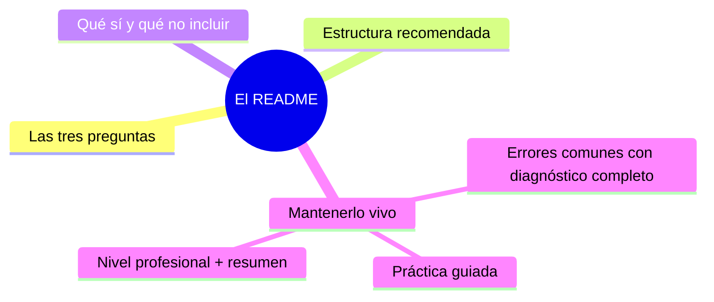

# El README
[`03-mensajes-de-commit.md`](03-mensajes-de-commit.md)

## Autopreguntas de cierre

Sin mirar el material, responde mentalmente y luego compruébalo con este capítulo:

1. ¿Por qué es esencial que el README responda primero al «qué», luego al «por qué» y finalmente al «cómo» en la experiencia de un nuevo visitante?
2. ¿Cómo afecta la decisión de colocar documentación extensiva (como manuales de API) en docs/ en lugar de saturar el README a la usabilidad y al mantenimiento del proyecto?
3. ¿Qué criterios debes usar para determinar si un bloque de información (por ejemplo, una tabla de configuración) pertenece al README o debe moverse a un documento separado en docs/?
4. ¿Cómo contribuyen los badges honesto y la práctica de «clon limpio» a la confianza de los usuarios potenciales y a la calidad percibida del proyecto?
5. ¿Qué consecuencias tiene omitir la sección de licencia o usar una licencia inadecuada para el tipo de proyecto y su audiencia?
6. ¿Cómo implementarías un proceso de revisión de PR que asegure que el README se mantenga sincronizado con los cambios en la interfaz de uso o instalación?

[`03-mensajes-de-commit.md`](03-mensajes-de-commit.md)
# El README

## Introducción

El README es la primera — y muchas veces única — página que leerán de tu proyecto. Responde tres preguntas en menos de un minuto: ¿qué es esto?, ¿por qué me importa? y ¿cómo empiezo?

Un README profesional no es un dumping ground de todo lo que sabes: es una puerta de entrada con enlaces al resto. Este capítulo enseña su estructura, su contenido mínimo y cómo mantenerlo vivo.

---
## Mapa conceptual de este capítulo



---
## 1. Las tres preguntas

```text
Cualquier lector (usuario, reclutador, compañero) hace:
    │
    ├── ¿QU܉ es?          → título + descripción
    ├── ¿POR QU܉?         → problema que resuelve
    └── ¿CܓMO empiezo?    → instalación y primer uso
```

```text
El orden de lectura real es de arriba abajo:
    │
    ├── los primeros 10 renglones deciden si siguen
    │
    └── por eso: beneficio ANTES que arquitectura
```

---
## 2. Estructura recomendada

```markdown
# Nombre del proyecto

Uno o dos párrafos: qué hace y para quién.
(Motivación: qué problema resuelve.)

![captura o logo] (opcional)

## Características
## Requisitos
## Instalación
## Uso rápido          ← ejemplo copiable
## Configuración       (si aplica)
## Documentación       ← enlaces a docs/
## Desarrollo          ← cómo contribuir (enlace)
## Estado / Roadmap    (si aplica)
## Licencia
```

```text
Ajustes según tipo de proyecto:
    │
    ├── librería → uso con snippets por lenguaje
    ├── app     → instalación + capturas
    ├── doc     → índice de guías
    └── portfolio → qué demuestra + enlaces
```

```bash
# ejemplo de bloque de uso que S܍ funciona:
git clone https://...
cd mi-proyecto
# seguir docs/PRIMEROS-PASOS.md
```

---
## 3. Qué sí y qué no incluir

```text
S܍ (puerta de entrada):
    │
    ├── promesa clara y verificable
    ├── ejemplo mínimo EJECUTABLE (copiar y pegar)
    ├── estado real («en desarrollo» / «estable»)
    ├── badges honestos (build, versión, licencia)
    └── enlaces: docs, contributing, glosario, FAQ
```

```text
NO (pertenece en docs/):
    │
    ├── manual completo del API (→ docs/)
    ├── historial entero del equipo (→ CHANGELOG/ADRs)
    ├── esquemas internos extensos (→ docs/arquitectura)
    └── textos de marketing vacíos sin evidencia
```

```text
    │
    ├── el README crece por ENLACES, no por absorción
    │
    └── si una sección supera ~50-80 líneas: extraer
        y enlazar
```

---
## 4. Mantenerlo vivo

```text
Señales de README muerto:
    │
    ├── los comandos del ejemplo ya no existen
    │
    ├── menciona archivos/ramas que cambiaron de nombre
    │
    └── nadie lo revisa en los PRs que tocan «cómo se
        usa»
```

```text
Higiene:
    │
    ├── revisar el README en PRs que cambian interfaz
    │   o instalación (checklist del equipo)
    │
    ├── badges con estado real (no decorativos)
    │
    └── «actualizado: …» no hace falta si el repo
        tiene historia viva: el README se revisa como
        código
```

---
## 5. Errores comunes con diagnóstico completo

### Error 1: asumir conocimiento del lector

**Qué ocurrió:** el README dice «ejecuta `make deploy`» sin decir qué es make, ni requisitos, ni de dónde sale.

**Por qué posibles:**
* escrito por quien ya entendía todo;
* sin prueba con un lector nuevo.

**Cómo comprobarlo:** pedir a alguien (o a ti, en una semana) que siga el README en una carpeta limpia.

**Opciones:** añadir requisitos, comandos completos, enlaces a prerrequisitos.

**Riesgos:** el 90% de lectores se va en el paso 2.

**Solución:** prueba de «clon limpio» periódica.

**Cómo se evita:** onboarding de cada release.

---

### Error 2: ejemplo que no funciona (copy-paste roto)

**Qué ocurrió:** copiaron el snippet y falla (pasos faltantes, rutas inventadas, flags viejos).

**Por qué:** no se probó en máquina limpia.

**Cómo comprobarlo:** ejecutar el ejemplo literalmente.

**Opciones:** corregir; añadir «resultado esperado» tras cada bloque.

**Riesgos:** pérdida de confianza inmediata.

**Solución:** los ejemplos del README se prueban como código (y CI puede verificarlo).

**Cómo se evita:** checklist de PR que toca README.

---

### Error 3: README gigante y desordenado

**Qué ocurrió:** 1000 líneas; nadie encuentra «cómo instalar».

**Por qué:** absorción de todo (punto 3).

**Cómo comprobarlo:** estructura de encabezados vs. longitud; tiempo de encontrar la instalación.

**Opciones:** extraer a `docs/`, dejar índice enlazado.

**Riesgos:** inutilidad.

**Solución:** regla de extracción (punto 3).

**Cómo se evita:** revisión de longitud en PR.

---

### Error 4: promesas no verificables / badges rotos

**Qué ocurrió:** «la librería más rápida» sin datos; badge de build que lleva meses roto o apunta a otro sitio.

**Por qué:** marketing sin evidencia; badges olvidados.

**Cómo comprobarlo:** clic en cada badge; métricas con fuente.

**Opciones:** quitar o matizar lo no demostrable; arreglar/retirar badges.

**Riesgos:** credibilidad.

**Solución:** solo lo que se puede señalar.

**Cómo se evita:** revisar badges al tocar CI.

---

### Error 5: README desincronizado con el código

**Qué ocurrió:** cambió la CLI (nuevos comandos) y el README describe la versión vieja.

**Por qué posibles:**
* el PR que cambió la interfaz no tocó README;
* no hay dueño del README.

**Cómo comprobarlo:** ejecutar el flujo del README con la versión actual.

**Opciones:** actualizar en el mismo PR (o PR de seguimiento inmediato); añadir a la checklist.

**Riesgos:** nuevos usuarios con la guía equivocada.

**Solución:** README incluido en la definición de «terminado».

**Cómo se evita:** plantillas de PR con casilla «README actualizado».

---

### Error 6: ocultar el estado real del proyecto

**Qué ocurrió:** parece producción-ready y es un prototipo (o al revés: subestima un proyecto maduro).

**Por qué:** vergüenza o marketing.

**Cómo comprobarlo:** comparar con el roadmap y la madurez real.

**Opciones:** sección de estado honesta («experimental», «uso en producción con…»).

**Riesgos:** decisiones equivocadas de los usuarios.

**Solución:** honestidad operativa.

**Cómo se evita:** revisar la sección de estado en cada release.

---
## 6. Práctica guiada

### Objetivo

Reescribir un README siguiendo las tres preguntas y probarlo en clon limpio.

### Paso 1: diagnóstico

```text
Toma el README de tu proyecto de práctica y responde:
    │
    ├── ¿en 30 segundos se entiende qué es?
    ├── ¿el primer ejemplo se puede copiar?
    └── ¿hay enlaces a docs sin engordar?
Marca lo que falte.
```

### Paso 2: esqueleto nuevo

1. Escribe los tres párrafos (qué / por qué / para quién).
2. Añade instalación y uso con código real (cap. 01).

### Paso 3: prueba de clon limpio

```bash
git clone <tu-repo> ../readme-test
cd ../readme-test
# ejecuta el README paso a paso, sin atajos
# anota cada fallo
```

### Paso 4: extraer

1. Mueve a `docs/` cualquier bloque que supere su tamaño y déjalo enlazado.

### Paso 5: revisión de enlaces

1. Comprueba cada enlace del README dentro del repo (relativos) y los externos.

### Paso 6: checklist de PR

1. Añade al CONTRIBUTING la casilla «README y docs afectadas actualizados».

### Resultado esperado

README probado en clon limpio, con estructura, enlaces y checklist de mantenimiento.

### Conclusión esperada

El README es un contrato con el lector: se escribe para quien llega por primera vez y se revisa como código.

### Ejercicio de transferencia

Imagina que debes documentación para una biblioteca de funciones matemáticas de uso interno en tu empresa. Redacta un README que siga la estructura de tres preguntas, incluya un ejemplo de uso mínimo con enlaces a la documentación detallada en `docs/` y añade una licencia adecuada para uso interno. Luego, verifica que un colega pueda clonar el repositorio y ejecutar el ejemplo sin leer ningún otro documento.

---
## 7. Nivel profesional + resumen

### 7.1. README como producto

```text
    │
    ├── métrica informal: «¿puede alguien ejecutar el
    │   ejemplo en 5 minutos?»
    │
    ├── revisión explícita en PRs de interfaz
    │
    ├── plantilla por tipo de proyecto (la organización
    │   tiene su README estándar)
    │
    └── en portafolios/reclutamiento: el README es tu
        carta de presentación técnica (sección 26)
```

### 7.2. Resumen

En este capítulo aprendiste que:

* el README responde qué es, por qué importa y cómo empezar — en ese orden, en la parte superior;
* estructura estándar: promesa, características, requisitos, instalación, uso copiable, enlaces a docs, licencia;
* el contenido crece por enlaces, no por absorción: manual/API van a `docs/`;
* se mantiene vivo: prueba en clon limpio, badges honestos, revisión en PRs de interfaz;
* los errores típicos (lector experto, snippets rotos, README gigante, promesas huecas, desincronización, estado falso) se previenen con pruebas y checklist;
* a nivel profesional: el README es parte de la entrega y de la reputación del proyecto.

La idea principal es:

> **Un README se escribe para el que llega mañana y se prueba como código hoy: promesa clara, ejemplo copiable y enlaces — nada más en la puerta.**

---
## Próximo paso

Ya tienes la portada.

La siguiente pieza de documentación viaja dentro del historial: el mensaje de commit.

Continúa con:

[`03-mensajes-de-commit.md`](03-mensajes-de-commit.md)
