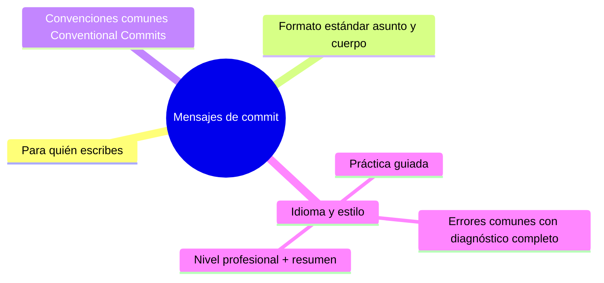

# Mensajes de commit
[`04-changelog-y-release-notes.md`](04-changelog-y-release-notes.md)

## Autopreguntas de cierre

Sin mirar el material, responde mentalmente y luego compruébalo con este capítulo:

1. ¿Por qué es importante que el asunto de un commit describa el «qué changed» en imperativo y el cuerpo explique el «por qué» con contexto y decisiones, en lugar de solo listar acciones?
2. ¿Cómo afecta el uso de convenciones como Conventional Commits a la generación automática de changelogs y a la capacidad de determinar el incremento de versión semver solo desde el historial?
3. ¿Qué impacto tiene mezclar idiomas o usar un tono emocional en los mensajes de commit sobre la utilidad del historial para auditorías y para nuevos miembros del equipo?
4. ¿Cómo decidir si un mensaje de commit debe incluir un enlace a un issue (p. ej., «Closes #123») y cuándo es suficiente dejar el contexto en el cuerpo sin referencia externa?
5. ¿Qué consecuencias tiene aplicar un rebase o amend a commits ya compartidos sin coordinar con el equipo, y cómo se evita este riesgo?
6. ¿Cómo implementarías una revisión de PR que verifique tanto el formato del asunto (longitud, imperativo) como la presencia de explicación del por qué en el cuerpo?

[`04-changelog-y-release-notes.md`](04-changelog-y-release-notes.md)
# Mensajes de commit

## Introducción

El historial de Git es la memoria del proyecto: cada commit deja una nota. Esa nota es lo primero que leerá quien investigue un bug dentro de seis meses, revise un relevo de equipo o necesite saber qué pasó y por qué.

Un mensaje de commit bien escrito transforma el log de Git en documentación viva. Mal escrito, lo convierte en ruido inútil. Este capítulo cubre formato, convención, idioma y los errores que arruinan un historial.

---
## Mapa conceptual de este capítulo



---
## 1. Para quién escribes

```text
Lectores reales del mensaje:
    │
    ├── tú, en 3 meses, preguntando «¿por qué está
    │   este if aquí?»
    │
    ├── quien revise el historial para auditar un
    │   cambio (release, incidente, seguridad)
    │
    ├── quien haga bisect buscando la regresión
    │   (sección 12) — el mensaje es su mapa
    │
    └── herramientas: changelogs automáticos,
        analytics, integración con issues
```

```text
Regla mental:
    │
    └── el asunto responde «qué cambió»;
        el cuerpo responde «por qué cambió»
        (el diff ya cuenta el «cómo»)
```

---
## 2. Formato estándar (asunto + cuerpo)

```text
ELEMENTOS
──────────────────────────────────────────────────────
asunto (subject)
   · una línea, ≤ 50 caracteres (costumbre clásica)
   · imperativo: «Añade…», «Corrige…», no «Añadido…»
   · sin punto final
   · mayúscula inicial según estilo del equipo

cuerpo (body) — opcional pero valioso
   · línea en blanco tras el asunto
   · párrafos de ≤ 72 caracteres
   · explica EL PORQU܉: contexto, problema, decisión
   · menciona trade-offs y alternativas descartadas

pie (footer) — opcional
   · vínculos: "Closes #123", "Refs: …"
   · notas de revisión: "Reviewed-by: …"
   · rompes API: "BREAKING CHANGE: …"
```

```text
EJEMPLO
──────────────────────────────────────────────────────
Corrige carrera al refrescar el token de sesión

Los refrescos concurrentes generaban dos rotaciones
y la segunda invalidaba la primera, dejando a los
usuarios sin sesión. Se serializa el refresco con la
cola ya existente en SessionManager.

Alternativa descartada: mutex global (mataba
concurrencia innecesaria en el resto del flujo).

Closes #482
```

```text
Por qué el imperativo («Corrige»): los mensajes
 forman la frase «este commit *corrige* …» al
 aplicarse (y así lo traduce git log --oneline).
```

---
## 3. Convenciones comunes

```text
CONVENTIONAL COMMITS (la más extendida)
    │
    ├── tipo(scope): descripción
    │     feat: funcionalidad nueva
    │     fix: corrección de bug
    │     docs: solo documentación
    │     style: formato (sin cambio de lógica)
    │     refactor: reestructurar sin cambiar
    │                     comportamiento
    │     test: añade/corriga tests
    │     chore: tareas de mantenimiento
    │     ci/build/perf: … según la convención del
    │                     equipo
    │
    ├── BREAKING CHANGE: ! o pie explícito
    │
    └── sirve a: changelogs automáticos, semver
        derivado, filtros de release
```

```text
feat(api): añade endpoint de exportación CSV
fix(parser): ignora comentarios multi-línea
docs(readme): corrige ejemplo de instalación

Otros esquemas (mención): imperative mood simple,
tipo de rama/issue en el mensaje — lo importante es
que el equipo elija UNO y lo documente.
```

```bash
# el mensaje en el commit:
git commit               # editor con plantilla
git commit -m "fix: ..." # una línea (sin cuerpo)
```

---
## 4. Idioma y estilo

```text
    │
    ├── idioma: el que el equipo documente; lo crítico
    │   es ser consistente y claro (en este repo, en
    │   español con terminología técnica intacta)
    │
    ├── no mezclar idiomas dentro de un historial
    │   sin criterio
    │
    ├── lenguaje neutro y profesional: sin sarcasmo,
    │   sin culpabilizar («chore: no funcionaba el
    │   review de Ana»)
    │
    └── nombra el dominio: «corrige cálculo de IVA en
        exportación» > «pequeño arreglo»
```

```text
Historial como disciplina:
    │
    ├── un commit = una idea revisable
    │
    ├── mensajes se reescriben ANTES de compartir
    │   (amend / rebase -i de la sección 12)
    │
    └── después de compartir: solo añadiendo (y con
        causa) — reescribir historial compartido
        obliga a coordinar
```

---
## 5. Errores comunes con diagnóstico completo

### Error 1: mensajes de relleno

**Qué ocurrió:** `git log` lleno de «update», «fix», «wip», «cambios».

**Por qué posibles:**
* prisa y hábito;
* commits automáticos de herramientas;
* plantilla ausente.

**Cómo comprobarlo:** `git log --oneline -20`.

**Opciones:** reescribir lo no compartido (amend, rebase -i); de lo compartido, mejorar desde ahora + regla de equipo.

**Riesgos:** historial inútil para bisect y auditoría.

**Solución:** plantilla de commit + revisión en PR.

**Cómo se evita:** plantilla (`.gitmessage`) y convención documentada en CONTRIBUTING.

---

### Error 2: asunto que no dice qué cambió

**Qué ocurrió:** «correcciones varias» o «review comments».

**Por qué:** se describe la acción («atendí comentarios») en vez del cambio del producto.

**Cómo comprobarlo:** leer solo el asunto: ¿sabes qué cambió en el sistema?

**Opciones:** reescribir («Corrige validación de correo en registro»).

**Riesgos:** imposible navegar el log.

**Solución:** asunto = cambio observable.

**Cómo se evita:** revisión de historial en el PR (no solo del diff).

---

### Error 3: el «por qué» vive solo en el PR

**Qué ocurrió:** el PR tiene discusión rica; el commit dice «fix»; la plataforma desaparece o el repo cambia de host y se pierde el contexto.

**Por qué:** asumir persistencia de la plataforma.

**Cómo comprobarlo:** leer el commit sin contexto externo.

**Opciones:** copiar la decisión esencial al cuerpo («Closes #123» mantiene el vínculo).

**Riesgos:** memoria frágil.

**Solución:** cuerpo con contexto + enlace al issue.

**Cómo se evita:** checklist: «¿se entiende sin abrir el PR?».

---

### Error 4: commits-basura creados por herramientas

**Qué ocurrió:** historial con «apply prettier», «merge remote-tracking», «temp» de IDEs.

**Por qué:** autocommit de extensiones; merge inmediatos innecesarios.

**Cómo comprobarlo:** `git log --oneline | Select-String 'temp|tmp|wip'`.

**Opciones:** limpiar lo no compartido (rebase -i, squash); configurar la herramienta para no autocommit; preferir rebase local sobre merges de sync (política del equipo, sección 16/17).

**Riesgos:** ruido permanente.

**Solución:** una política de sincronización y de commits automáticos.

**Cómo se evita:** revisar la configuración del IDE al entrar al proyecto.

---

### Error 5: estilo inconsistente en el mismo historial

**Qué ocurrió:** unos «Fix:», otros «fixup!», otros español/inglés mezclados.

**Por qué:** convención no acordada o no aplicada.

**Cómo comprobarlo:** muestra de 50 mensajes.

**Opciones:** documentar la convención; aplicar desde ya; (lo histórico: se respeta salvo reescritura coordinada).

**Riesgos:** herramientas (changelog) fallan; lectores confundidos.

**Solución:** CONTRIBUTING con ejemplos correctos e incorrectos.

**Cómo se evita:** PR review que también mira mensajes.

---

### Error 6: mensajes engañosos o que culpan

**Qué ocurrió:** «arreglo estúpido de X», «no tocar esto» sin explicación, mensajes que no coinciden con el diff (fix que no arregla nada).

**Por qué posibles:**
* descuido;
* commits mal separados (mezclan cambios);
* tono emocional.

**Cómo comprobarlo:** revisar diff vs. mensaje; revisar tono.

**Opciones:** reescribir (si no compartido); separar cambios mal agrupados.

**Riesgos:** mala relación, auditoría errónea.

**Solución:** mensaje profesional + un commit = una idea.

**Cómo se evita:** reglas de estilo del equipo y pausa de 10 segundos antes de `git commit`.

---
## 6. Práctica guiada

### Objetivo

Escribir un par de commits con formato completo y limpiar el historial de prueba.

### Paso 1: plantilla

```bash
git config --global commit.template ~/.gitmessage.txt
```

```text
# ~/.gitmessage.txt (plantilla en español)
# <tipo>(<ámbito>): <asunto en imperativo, ≤50>
#
# Por qué: <contexto y problema>
# Alternativas: <si aplica>
#
# Closes #nnn
```

### Paso 2: commit con cuerpo

```bash
echo "cambio" >> nota.txt
git add nota.txt
git commit           # escribe asunto + cuerpo en el
                      # editor
git log -1 --format=full   # verifica estructura
```

### Paso 3: analizar un historial malo

```bash
git log --oneline -10
# clasifica: ¿qué es ruido? ¿qué responde al «qué»?
# ¿algún «por qué» que solo vive en el PR?
```

### Paso 4: limpiar (solo historia NO compartida)

```bash
git reset --soft HEAD~2      # deshace 2 commits
                               # manteniendo cambios
git commit                   # rehace con mensajes
                               # buenos
# o git rebase -i HEAD~2 with reword/squash
# (sección 12)
```

### Paso 5: convención en el equipo

1. Escribe en CONTRIBUTING: formato, ejemplo bueno, ejemplo malo, cuándo «Closes #x».

### Resultado esperado

Historial de prueba legible: asuntos que cuentan el qué, cuerpos con el porqué, plantilla instalada.

### Conclusión esperada

El mensaje es la capa semántica del historial: se redacta como mini-documento y se revisa como parte del PR.

### Ejercicio de transferencia

Elige un proyecto de código abierto pequeño con el que nunca hayas contribuido. Envía un pull request que incluya al menos dos commits: uno con mensaje siguiendo Conventional Commits (tipo, ámbito, asunto ≤50) y otro que corrija un error menor. Asegúrate de que el cuerpo del primer commit explique el por qué con contexto y que el historial resultante sea legible y útil para un revisor externo. Entrega capturas del historial antes y después, junto con el mensaje del pull request.

---
## 7. Nivel profesional + resumen

### 7.1. Historial como artefacto de ingeniería

```text
    │
    ├── convención + plantilla + hooks de lint de
    │   mensajes (categoría: commitlint) in CI
    │
    ├── changelog derivado (feat/fix/BREAKING) y
    │   semver derivado del historial
    │
    ├── historial que sobrevive a migraciones de
    │   plataforma (por eso el contexto está en el
    │   commit, no solo en el PR)
    │
    └── reescritura: solo lo local/no compartido, o
        coordinación completa (sección 12, cap. 01)
```

### 7.2. Resumen

En este capítulo aprendiste que:

* el asunto dice «qué» (imperativo, ≤50, una línea) y el cuerpo dice «por qué» (contexto, decisiones, alternativas);
* el pie enlaza issues y marca breaking changes;
* Conventional Commits (`tipo(scope):`) alimenta changelogs y releases automáticos;
* el idioma y el tono se eligen como equipo: consistencia, profesionalidad, dominio nombrado;
* los errores típicos (relleno, asuntos vacíos, porqué solo en PR, ruido de herramientas, inconsistencia, mensajes engañosos) se previenen con plantilla, revisión de historial y convención escrita;
* a nivel profesional: historial tratado como artefacto de ingeniería, reescrito solo antes de compartirse.

La idea principal es:

> **El historial es documentación ejecutable: escribe para quien lo leerá dentro de un año, con el qué en una línea y el porqué en el cuerpo.**

---
## Próximo paso

Ya sabes documentar el pasado commit a commit.

El siguiente paso documenta el pasado a gran escala: changelogs y notas de versión.

Continúa con:

[`04-changelog-y-release-notes.md`](04-changelog-y-release-notes.md)
