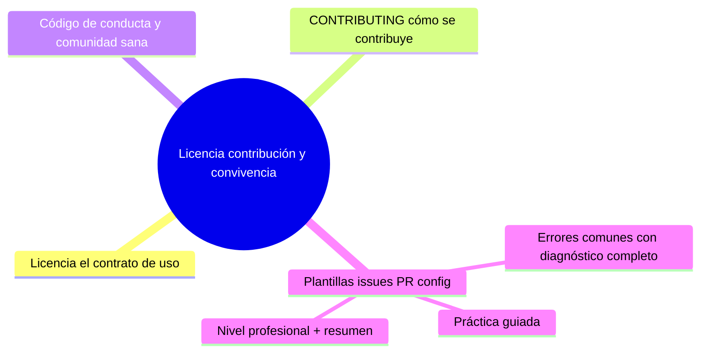

# Licencia, contribución y convivencia
[`README.md`](README.md)

## Autopreguntas de cierre

Sin mirar el material, responde mentalmente y luego compruébalo con este capítulo:

1. ¿Por qué es crítico decidir y colocar una licencia en el repositorio antes de aceptar contribuciones externas, y qué riesgos legales se asumen al publicar código sin licencia?
2. ¿Cómo afecta elegir una licencia permisiva (como MIT) versus una copyleft (como GPL) a la posibilidad de que empresas privadas usen, modifiquen y distribuyan el software, y qué implicaciones tiene esto para la estrategia de adopción del proyecto?
3. ¿Qué elementos esenciales debe incluir un archivo CONTRIBUTING para reducir la fricción con nuevos colaboradores, y cómo influye la claridad del flujo de trabajo (fork/rama ? PR ? revisión) en la calidad y rapidez de las contribuciones aceptadas?
4. ¿Por qué es necesario que un código de conducta incluya un mecanismo de denuncia real y un contacto responsable, y qué consecuencias tiene la falta de estos elementos en la capacidad de gestionar incidentes de acoso o discriminación en el proyecto?
5. ¿Cómo decidir qué información pertenece en una plantilla de issue o de PR, y qué principio guía la inclusión de solo los campos que se verifican realmente (por ejemplo, mediante checks de CI) para evitar listas decorativas que generan falsa confianza?
6. ¿Qué pasos seguirías para asegurarte de que las dependencias de tu proyecto no introduzcan licencias incompatibles, y cómo integrar un escaneo de licencias en la cadena de CI para detectar problemas antes de que lleguen a producción?

[`README.md`](README.md)
# Licencia, contribución y convivencia

## Introducción

Un repositorio es jurídicamente un «todos los derechos reservados» por defecto: sin licencia, nadie puede usar, modificar ni redistribuir tu código legalmente — ni siquiera con buena intención. Y cuando llegan contribuciones, hace falta un acuerdo de convivencia: cómo se propone, revisa y acepta el trabajo de otros.

Este capítulo cubre la licencia (qué elegir y por qué), el CONTRIBUTING, el código de conducta y las plantillas de issues/PR: el marco que convierte un repo personal en un proyecto con comunidad.

---
## Mapa conceptual de este capítulo



---
## 1. Licencia: el contrato de uso

```text
SIN licencia:
    │
    └── copyright total: otros NO pueden usarlo
        legalmente (ni forks «útiles»), aunque el
        código sea visible
```

```text
OPCIONES POPULARES (criterios, no asesoría legal)
──────────────────────────────────────────────────────
MIT
   · permisiva, mínimo texto
   · uso comercial, modificación, distribución
   · sin garantía; conserva el aviso de copyright
   · el más usado para librerías pequeñas

Apache-2.0
   · permisiva como MIT +
   · patentes explícitas (cesión de licencia de
     patentes de los contribuidores)
   · aviso de cambios
   · común en proyectos corporativos/ grandes

GPL (v3)
   · copyleft: derivados deben abrir su código bajo
     la misma licencia
   · «contagio» intencional para preservar libertades

BSD / MPL / ISC / otros
   · variantes permissivas o copyleft «por archivo»
   · comparar según caso
```

```text
Dónde va:
    │
    ├── archivo LICENSE (o COPYING) en la raíz —
    │   GitHub lo detecta y lo muestra
    │
    ├── cabecera en README: «Licencia: MIT»
    │
    └── dependencias: la licencia de TU proyecto no
        cambia la de las de terceros (compatibilidad:
        p. ej. no puedes meter GPL en un binario
        propietario)
```

```text
    │
    ├── © años y titular: `Copyright (c) 2026 Nombre`
    │
    ├── licencias de contenido/docs: puede ser otra
    │   (decisión explícita)
    │
    └── esto NO es asesoría legal: para producto con
        patentes/empresa, consulta profesional
```

---
## 2. CONTRIBUTING: cómo se contribuye

```text
CONTENIDO DEL ARCHIVO CONTRIBUTING.md
    │
    ├── qué tipo de contribuciones se aceptan (y qué
    │   NO se acepta)
    ├── flujo: fork/rama → PR → revisión → merge
    ├── reglas de commits (convención, cap. 03)
    ├── cómo ejecutar el proyecto y los tests
    ├── estilo y linters (si los hay)
    ├── procesado de bugs (plantilla de issue)
    ├── DCO/CLA si el proyecto los exige (mención)
    └── a quién preguntar (discusiones, issues)
```

```text
    │
    ├── un buen CONTRIBUTING reduce PRs que se
    │   cierran por mal formato
    │
    └── guía de revisión: qué se espera en un PR
        (tamaño, tests, docs) — clave en la sección
        15
```

---
## 3. Código de conducta y comunidad sana

```text
CODE_OF_CONDUCT.md
    │
    ├── conducta esperada (respeto, colaboración)
    ├── conducta inaceptable (acoso, discriminación)
    ├── mecanismo de denuncia y contacto responsable
    └── consecuencias aplicadas
```

```text
Por qué importa técnicamente:
    │
    ├── sin reglas, la moderación se vuelve arbitraria
    │   (incidentes mal resueltos ahuyentan
    │   contribuidores)
    │
    └── proyectos «con casa en orden» atraen más
        colaboración sostenible
```

```text
Plantillas de conducta conocidas: Contributor
Covenant (mención); el texto se adapta al proyecto.
```

---
## 4. Plantillas (issues, PR, config)

```text
.github/
├── ISSUE_TEMPLATE/
│   ├── bug.yml            → formulario: pasos,
│   │                        esperado, obtenido, SO
│   └── feature.yml        → propuesta
├── PULL_REQUEST_TEMPLATE.md → checklist
└── config.yml             → enlaces (docs, FAQ,
                              discusiones)
```

```markdown
<!-- PULL_REQUEST_TEMPLATE.md -->
- [ ] Descripción del cambio
- [ ] Relacionado con la issue #nnn
- [ ] Tests añadidos/actualizados
- [ ] Documentación actualizada
- [ ] No rompe compatibilidad (o está documentado)
```

```text
    │
    ├── el formulario (issues en YAML) guía al
    │   reportante y ahorra idas y vueltas
    │
    ├── la checklist del PR estandariza la revisión
    │   (sección 15)
    │
    └── GitHub también permite configurar el repo
        (.github) con reglas de seguridad/gobernanza —
        sección 18
```

---
## 5. Errores comunes con diagnóstico completo

### Error 1: publicar sin licencia

**Qué ocurrió:** el código es visible pero nadie puede usarlo (ni forks legales, ni empresas interesadas).

**Por qué:** desconocimiento («si está en GitHub se puede usar»).

**Cómo comprobarlo:** existe LICENSE en raíz; GitHub muestra el badge de licencia.

**Opciones:** añadir licencia (decisión del titular de copyright); actualizar README.

**Riesgos:** fricción legal y cero adopción.

**Solución:** elegir licencia al crear el proyecto, no «algún día».

**Cómo se evita:** plantilla de repositorio con LICENSE (sección 18).

---

### Error 2: elegir licencia «por moda» sin entender copyleft

**Qué ocurrió:** proyecto bajo GPL sin querer obligar a abrir derivados (o al revés: Apache pensando que «es libre como GPL»).

**Por qué:** se copió la licencia de otro repo.

**Cómo comprobarlo:** leer la licencia; preguntar «¿qué pasa si mi cliente…?».

**Opciones:** cambiar de licencia ANES de contribuciones de terceros (con ellos); después es más difícil.

**Riesgos:** incompatibilidad con el uso previsto.

**Solución:** decidir con criterio (permisiva vs. copyleft) antes del primer contribuyente.

**Cómo se evita:** documento breve de «por qué esta licencia» en la doc del proyecto.

---

### Error 3: CONTRIBUTING que no refleja el proceso real

**Qué ocurrió:** dice «haz fork y rama larga» pero el equipo trabaja con ramas cortas y PRs atados a issues.

**Por qué:** se copió una plantilla y nadie la actualizó.

**Cómo comprobarlo:** comparar con los últimos 5 PRs reales.

**Opciones:** reescribir con el flujo actual; verificar con un contribuyente nuevo.

**Riesgos:** contribuidores frustrados, PRs mal formados.

**Solución:** tratar CONTRIBUTING como documentación viva (revisar en cambios de proceso).

**Cómo se evita:** dueño del archivo y casilla en PRs de proceso.

---

### Error 4: checklist de PR decorativa

**Qué ocurrió:** las casillas se marcan sin leerse («tests: ✓» con tests rotos).

**Por qué:** checklist sin revisión; demasiadas casillas irrelevantes.

**Cómo comprobarlo:** PR con casillas marcadas y CI rojo.

**Opciones:** reducir a lo que se verifica; hacer cumplir lo automatizable en CI (casillas → checks reales).

**Riesgos:** falsa confianza.

**Solución:** checklist pequeña y verificable.

**Cómo se evita:** pasar a checks de CI lo que CI puede comprobar.

---

### Error 5: código de conducta sin canal de denuncia

**Qué ocurrió:** hay COC pero no hay a quién escribir (o el contacto es anónimo e inexistente).

**Por qué:** plantilla incompleta.

**Cómo comprobarlo:** leer la sección de contacto.

**Opciones:** definir responsable(es) y canal privado.

**Riesgos:** imposibilidad de gestionar incidentes.

**Solución:** contacto real y procedimiento.

**Cómo se evita:** revisión anual de gobernanza (sección 18).

---

### Error 6: ignorar licencias de dependencias

**Qué ocurrió:** tu proyecto MIT incluye una dependencia GPL incompatible, o una dependencia sin licencia clara.

**Por qué:** instalación sin revisar `package.json`/`requirements`.

**Cómo comprobarlo:** herramienta de inventario de licencias (categoría: SBOM/scan); revisar dependencias directas.

**Opciones:** reemplazar la dependencia; acortar el alcance (no redistribuir); asesoría si es producto.

**Riesgos:** obligación de abrir tu código o demanda.

**Solución:** revisar licencias en el alta de dependencias.

**Cómo se evita:** escaneo en CI (sección 24).

---
## 6. Práctica guiada

### Objetivo

Dejar un repo «con casa en orden»: licencia, CONTRIBUTING, COC y plantillas.

### Paso 1: licencia

1. Elige licencia (MIT/Apache-2.0/GPL según criterio del punto 1).
2. Crea `LICENSE` con el texto íntegro + copyright.
3. Menciónalo en README («Licencia: …»).

### Paso 2: CONTRIBUTING

```markdown
# Cómo contribuir
1. Abre una issue antes de PR grande.
2. Rama: `feat/…` o `fix/…` desde main.
3. Commits según convención (ver 03).
4. Tests y docs actualizados.
5. PR con checklist; revisión en 48h.
```

### Paso 3: plantillas

1. Crea `.github/ISSUE_TEMPLATE/bug.yml` con formulario (pasos, esperado, obtenido).
2. Crea `.github/PULL_REQUEST_TEMPLATE.md` con la checklist del punto 4.

### Paso 4: COC

1. Añade `CODE_OF_CONDUCT.md` con conducta, anti-conducta y contacto.

### Paso 5: verificación

```text
Comprueba en la plataforma:
    │
    ├── la licencia aparece en «About»
    ├── abrir una issue muestra el formulario
    ├── abrir un PR muestra la checklist
    └── los enlaces de CONTRIBUTING funcionan
```

### Resultado esperado

Repo con contrato de uso y flujo de contribución funcionando en la plataforma.

### Conclusión esperada

La gobernanza mínima (licencia + CONTRIBUTING + COC + plantillas) es barata de montar y evita la mitad de la fricción con colaboradores.

### Ejercicio de transferencia

Imagina que estás incorporando una nueva dependencia de bajo nivel (por ejemplo, una biblioteca de criptografía) a tu proyecto con licencia MIT. Antes de fusionar el cambio, revisa la licencia de la dependencia y verifica su compatibilidad con MIT usando una herramienta de escaneo de licencias en CI. Luego, actualiza el archivo CONTRIBUTING para incluir una sección sobre la revisión de licencias de dependencias y añade un checkpoint en la plantilla de PR que oblige a confirmar que se ha realizado dicho escaneo. Entrega el informe de escaneo, el diff de CONTRIBUTING y la captura de la checkmark en la PR.

---
## 7. Nivel profesional + resumen

### 7.1. Gobernanza que escala

```text
NIVELES
    │
    ├── repositorio personal: LICENSE + CONTRIBUTING
    │   básico + plantilla de issue
    │
    ├── proyecto con comunidad: COC + revisores por
    │   área + CODEOWNERS + normas de release
    │   (sección 18)
    │
    └── organización: políticas de licencia aprobadas,
        escaneo de dependencias (SBOM), CLA/DCO según
        legal, SECURITY.md para reportes (sección 20)
```

```text
Documentos clave (raíz o .github/):
    │
    ├── LICENSE · CONTRIBUTING · CODE_OF_CONDUCT
    ├── SECURITY.md · SUPPORT.md (mención)
    └── plantillas de issue/PR
```

### 7.2. Resumen

En este capítulo aprendiste que:

* sin licencia hay copyright total: nadie puede usar el proyecto legalmente; MIT/Apache/GPL cubren perfiles distintos (permisivo, patentes, copyleft);
* decidir la licencia ANTES de las contribuciones de terceros y revisar compatibilidad de dependencias;
* CONTRIBUTING documenta el flujo real (rama, commits, tests, PR) y se mantiene como doc viva;
* el COC exige canal de denuncia real; plantillas de issue/PR estandarizan la entrada;
* los errores típicos (sin licencia, licencia por moda, CONTRIBUTING desfasado, checklist decorativa, COC incompleto, dependencias sin revisar) se previenen con revisión y automatización;
* a nivel profesional: gobernanza por niveles (repositorio → comunidad → organización).

La idea principal es:

> **El marco legal y social de un repo se declara en archivos: licencia que permite usarlo, CONTRIBUTING que dice cómo ayudar y reglas que protegen a quien colabora.**

---
## Próximo paso

Has completado la documentación esencial.

Cierra la sección con el índice:

[`README.md`](README.md)
