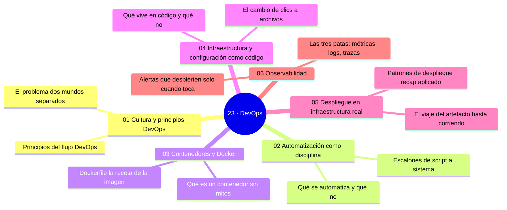

# 23 — DevOps

## Bienvenido a esta sección

DevOps es el marco queune todo lo que has construido: cultura de un solo flujo, automatización disciplinada, contenedores reproducibles, infraestructura en código, despliegue sobre terreno real y observabilidad que cierra el bucle. En esta sección, Git aparece como la columna vertebral de la ingeniería completa — no solo como control de versiones.

## En esta sección estudiarás

* la cultura DevOps: principios, bucle de retroalimentación, dueños y métricas de flujo;
* automatización como disciplina: de checklist a sistema, versionada y probada;
* contenedores y Docker: imágenes reproducibles, capas, versionado y seguridad;
* infraestructura y configuración como código: plan, apply y drift;
* despliegue en infraestructura real: la cadena completa, dominios, salud y seguridad;
* observabilidad: métricas, logs, trazas, alertas y SLO.

## Objetivos de aprendizaje

Al terminar esta sección serás capaz de:

* explicar los principios DevOps y el bucle de retroalimentación con métricas de flujo;
* automatizar como disciplina: scripts con dueño, idempotentes y versionados en Git;
* construir y versionar imágenes Docker reproducibles;
* manejar infraestructura y configuración como código con plan/apply y detección de drift;
* desplegar sobre infraestructura real: cadena completa, dominios, salud y seguridad;
* cerrar el bucle con observabilidad: métricas, logs, trazas, alertas y SLO.

## Mapa conceptual

---
## ¿Qué aprenderás en esta sección?

1. [`01-cultura-y-principios-devops.md`](01-cultura-y-principios-devops.md) — el bucle y su barómetro.
2. [`02-automatizacion-como-disciplina.md`](02-automatizacion-como-disciplina.md) — scripts con dueño, idempotentes y en Git.
3. [`03-contenedores-y-docker.md`](03-contenedores-y-docker.md) — la receta que elimina «en mi máquina funciona».
4. [`04-infraestructura-y-configuracion-como-codigo.md`](04-infraestructura-y-configuracion-como-codigo.md) — plan, apply y reconciliación de drift.
5. [`05-despliegue-en-infraestructura-real.md`](05-despliegue-en-infraestructura-real.md) — el viaje del artefacto hasta corriendo.
6. [`06-observabilidad.md`](06-observabilidad.md) — las señales que cierran el bucle.

## Cómo estudiar esta sección

Trabaja en el mismo orden que la sección: primero los acuerdos (cultura, automatización), luego la maquinaria (contenedores, infraestructura) y por último el terreno (despliegue, observabilidad). El cierre práctico es trazar el bucle completo de tu proyecto: idea → código → entrega → operación → señal → siguiente idea.

## Referencias

* Kim, G. et al. — *The Phoenix Project* (2014) — la cultura en narrativa.
* Kim, G., DeBois, K. y Willis, P. — *The DevOps Handbook* (2016).
* Docker — Documentación oficial (docs.docker.com).
* Google SRE Book — monitorización y SLOs (sre.google).

---

## Checkpoint 23 — Comprobación obligatoria

Antes de avanzar a `../24-devsecops/`, demuestra que puedes (en un repositorio de práctica real):

1. **Explica** el bucle de retroalimentación de DevOps y cómo se mide con métricas de flujo.
2. **Crea** un script idempotente con dueño y versionalo en Git.
3. **Construye** una imagen Docker reproducible a partir de un Dockerfile y publícala en un registro.
4. **Define** infraestructura como código con plan/apply y detecta drift en un entorno de práctica.
5. **Despliega** un artefacto en infraestructura real siguiendo la cadena completa y verificando dominios, salud y seguridad.
6. **Configura** métricas, logs y trazas para un servicio y define un SLO basado en esas señales.

Si puedes hacerlo **sin mirar instrucciones**, el checkpoint está cerrado.

## Autopreguntas de cierre

Sin mirar el material, responde mentalmente y luego compruébalo con los capítulos de la sección:

1. ¿Qué diferencia hay entre «automatización» y «un script que solo funciona en tu máquina»?
2. ¿Qué es un drift en infraestructura como código y cómo se detecta?
3. ¿Cuáles son las cuatro métricas de DORA?
4. ¿Qué diferencia hay entre una alerta y un SLO?
5. ¿Cómo afecta un drift no detectado en la infraestructura como código al ciclo de retroalimentación de DevOps?
6. ¿Por qué es importante que las alertas estén vinculadas a síntomas de usuario y no solo a métricas internas de rendimiento?

---

## Próximo paso

Cuando termines los seis capítulos, continúa con la siguiente sección:

[`../24-devsecops/`](../24-devsecops/)