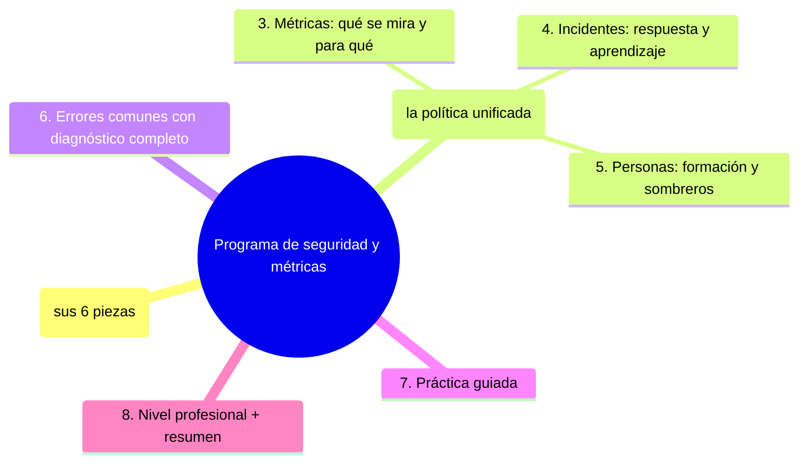

# Programa de seguridad y métricas

## Introducción

Un conjunto de herramientas no es un programa: lo es cuando tiene dueños, puertas definidas, métricas que se miran, respuesta ante incidentes y una costumbre de mejorar. Este capítulo cierra la sección DevSecOps ensamblando todo lo anterior en un programa mínimo viable para cualquier equipo —” desde un proyecto con una persona hasta una organización con auditorías —” y definiendo qué medir para saber si la seguridad del flujo funciona de verdad.

---\n\n## Autopreguntas de cierre\nSin mirar el material, responde mentalmente y luego compruébalo con este capítulo:\n1. ¿Cuáles son las seis piezas esenciales de un programa mínimo de seguridad y por qué es necesario que todas estén presentes para considerar que se tiene un programa y no solo una colección de herramientas?\n2. ¿Cómo se compone la tabla unificada de puertas y severidad y qué información contiene para guiar las decisiones de seguridad en el flujo?\n3. ¿Cuáles son las cuatro familias de métricas descritas en el capítulo y qué pregunta clave responde cada familia?\n4. ¿Cuál es la estructura común de respuesta a incidentes y qué elementos debe incluir un post-mortem efectivo para generar aprendizaje?\n5. ¿Cómo se integra la formación y la rotación de sombreros en equipos pequeños para garantizar que el conocimiento de seguridad se comparta y no quede en una sola persona?\n6. ¿Qué riesgos existen si se permiten métricas decorativas o post-mortems sin acciones aplicadas, y cómo se mitigan esos riesgos mediante reglas claras?\n\n
## Mapa conceptual de este capítulo



---\n\n## Autopreguntas de cierre\nSin mirar el material, responde mentalmente y luego compruébalo con este capítulo:\n1. ¿Cuáles son las seis piezas esenciales de un programa mínimo de seguridad y por qué es necesario que todas estén presentes para considerar que se tiene un programa y no solo una colección de herramientas?\n2. ¿Cómo se compone la tabla unificada de puertas y severidad y qué información contiene para guiar las decisiones de seguridad en el flujo?\n3. ¿Cuáles son las cuatro familias de métricas descritas en el capítulo y qué pregunta clave responde cada familia?\n4. ¿Cuál es la estructura común de respuesta a incidentes y qué elementos debe incluir un post-mortem efectivo para generar aprendizaje?\n5. ¿Cómo se integra la formación y la rotación de sombreros en equipos pequeños para garantizar que el conocimiento de seguridad se comparta y no quede en una sola persona?\n6. ¿Qué riesgos existen si se permiten métricas decorativas o post-mortems sin acciones aplicadas, y cómo se mitigan esos riesgos mediante reglas claras?\n\n
## 1. El programa mínimo (sus 6 piezas)

```text
1. CONTROLES POR PUERTA (las secciones 19/20/24 —”
   lista maestra, sección 04 cap. 04 Paso 2)
   │
2. DUEÅOS (por repo y por control —” sección 16 cap.
   06)
   │
3. POL܍TICA DE SEVERIDAD (qué bloquea, qué backlog,
   con qué SLA —” cap. 02 punto 2)
   │
4. INVENTARIO (dependencias, integraciones, accesos,
   credenciales —” sección 20 cap. 01/03)
   │
5. RESPUESTA (guiones de incidente: secretos,
   suministro, rollback —” sección 20 cap. 01 / 22
   cap. 06 / cap. 05 de esta sección)
   │
6. MEJORA CONTINUA (retro con datos + post-mortem con
   control nuevo —” sección 23 cap. 01)
```

```text
   │
   ┼”── si una pieza falta, el programa no es un
       programa: es una colección de features (Error 1
       —” revisa cuál te falta hoy)
```

---\n\n## Autopreguntas de cierre\nSin mirar el material, responde mentalmente y luego compruébalo con este capítulo:\n1. ¿Cuáles son las seis piezas esenciales de un programa mínimo de seguridad y por qué es necesario que todas estén presentes para considerar que se tiene un programa y no solo una colección de herramientas?\n2. ¿Cómo se compone la tabla unificada de puertas y severidad y qué información contiene para guiar las decisiones de seguridad en el flujo?\n3. ¿Cuáles son las cuatro familias de métricas descritas en el capítulo y qué pregunta clave responde cada familia?\n4. ¿Cuál es la estructura común de respuesta a incidentes y qué elementos debe incluir un post-mortem efectivo para generar aprendizaje?\n5. ¿Cómo se integra la formación y la rotación de sombreros en equipos pequeños para garantizar que el conocimiento de seguridad se comparta y no quede en una sola persona?\n6. ¿Qué riesgos existen si se permiten métricas decorativas o post-mortems sin acciones aplicadas, y cómo se mitigan esos riesgos mediante reglas claras?\n\n
## 2. Puertas y severidad (la política unificada)

```text
TABLA ÜšNICA (la que vienes construyendo):
──────────────────────────────────────────────────────
PUERTA        BLOQUEA                  BACKLOG CON SLA
editor        secretos locales         —”
PR            secretos, SAST crítico,  warnings,
              deps con CVE alto        días—“semanas
main/build    imágenes vulnerables,    medio plazo
              receta fija
staging       DAST crítico, humo       resto
deploy        gate: checks + hallazgos —”
              bloqueantes + aprobación
operación     alertas de SLO           post-mortem
```

```text
SLA POR SEVERIDAD (ejemplo —” define los tuyos):
   │
   ├── crítico/explotable: horas (mitigar hoy)
   ├── alto: días (7)
   ┼”── medio/bajo: semanas (30)
```

```text
   │
   ┼”── la tabla ES el programa en una página: quien
       llega nuevo la entiende en 10 minutos (Error 2
       si no existe)
```

---\n\n## Autopreguntas de cierre\nSin mirar el material, responde mentalmente y luego compruébalo con este capítulo:\n1. ¿Cuáles son las seis piezas esenciales de un programa mínimo de seguridad y por qué es necesario que todas estén presentes para considerar que se tiene un programa y no solo una colección de herramientas?\n2. ¿Cómo se compone la tabla unificada de puertas y severidad y qué información contiene para guiar las decisiones de seguridad en el flujo?\n3. ¿Cuáles son las cuatro familias de métricas descritas en el capítulo y qué pregunta clave responde cada familia?\n4. ¿Cuál es la estructura común de respuesta a incidentes y qué elementos debe incluir un post-mortem efectivo para generar aprendizaje?\n5. ¿Cómo se integra la formación y la rotación de sombreros en equipos pequeños para garantizar que el conocimiento de seguridad se comparta y no quede en una sola persona?\n6. ¿Qué riesgos existen si se permiten métricas decorativas o post-mortems sin acciones aplicadas, y cómo se mitigan esos riesgos mediante reglas claras?\n\n
## 3. Métricas: qué se mira y para qué

```text
CUATRO FAMILIAS (cada una responde una pregunta):
   │
   ├── ¿detectamos a tiempo?
   │     · % hallazgos descubiertos en PR vs. después
   │     · tiempo medio PR→corrección (por severidad)
   │
   ├── ¿está limpio?
   │     · alertas abiertas y su antigüedad (sección
   │       20 cap. 02/03)
   │     · cobertura de controles (repos con checklist
   │       completa)
   │
   ├── ¿respondemos?
   │     · tiempo de acotación en simulacros (cap. 05
   │       Paso 5)
   │     · MTTR de incidentes (sección 23 cap. 01)
   │
   ┼”── ¿mejoramos?
        · reincidencias (¿mismo post-mortem 2 veces?)
        · excepciones abiertas (bypass, emergencias)
```

```text
REGLA DE ORO (sección 23 cap. 01 Error 3):
   │
   ├── las métricas son BARÜ“METRO para conversar en la
   │   retro —” no nota, no ranking, no castigo
   │
   ┼”── cada métrica tiene PREGUNTA asociada: si nadie
       hace la pregunta, se retira la métrica
```

```text
   │
   ┼”── empieza con DOS: hallazgos en PR vs. después y
       alertas abiertas > SLA. Con dos que se miren,
       vales más que con veinte decorativos (Error 3)
```

---\n\n## Autopreguntas de cierre\nSin mirar el material, responde mentalmente y luego compruébalo con este capítulo:\n1. ¿Cuáles son las seis piezas esenciales de un programa mínimo de seguridad y por qué es necesario que todas estén presentes para considerar que se tiene un programa y no solo una colección de herramientas?\n2. ¿Cómo se compone la tabla unificada de puertas y severidad y qué información contiene para guiar las decisiones de seguridad en el flujo?\n3. ¿Cuáles son las cuatro familias de métricas descritas en el capítulo y qué pregunta clave responde cada familia?\n4. ¿Cuál es la estructura común de respuesta a incidentes y qué elementos debe incluir un post-mortem efectivo para generar aprendizaje?\n5. ¿Cómo se integra la formación y la rotación de sombreros en equipos pequeños para garantizar que el conocimiento de seguridad se comparta y no quede en una sola persona?\n6. ¿Qué riesgos existen si se permiten métricas decorativas o post-mortems sin acciones aplicadas, y cómo se mitigan esos riesgos mediante reglas claras?\n\n
## 4. Incidentes: respuesta y aprendizaje

```text
RESPUESTA (estructura común —” sección 22 cap. 06):
   │
   ├── 1. contener (pausar, revertir, rotar —” según el
   │       tipo: guion correspondiente)
   ├── 2. comunicar (canal y dueños —” sección 16)
   ├── 3. resolver/verificar (humo, escaneo)
   ┼”── 4. post-mortem SIN CULPA en < 48 h
```

```text
POST-MORTEM QUE SIRVE (plantilla):
   │
   ├── línea temporal (de observabilidad —” sección 23
   │   cap. 06)
   ├── causa raíz (sin «el junior clicó» —” mira el
   │   control que faltaba)
   ├── acciones: dueño + fecha + tipo de control
   │   (¿qué puerta ahora lo evitaría?)
   ┼”── registro: ¿se aplicó la acción? (si no, se
       repite el incidente —” Error 4)
```

```text
   │
   ┼”── el incidente cierra cuando el CONTROL existe,
       no cuando el servicio vuelve (sección 22 cap.
       06 Error 7)
```

---\n\n## Autopreguntas de cierre\nSin mirar el material, responde mentalmente y luego compruébalo con este capítulo:\n1. ¿Cuáles son las seis piezas esenciales de un programa mínimo de seguridad y por qué es necesario que todas estén presentes para considerar que se tiene un programa y no solo una colección de herramientas?\n2. ¿Cómo se compone la tabla unificada de puertas y severidad y qué información contiene para guiar las decisiones de seguridad en el flujo?\n3. ¿Cuáles son las cuatro familias de métricas descritas en el capítulo y qué pregunta clave responde cada familia?\n4. ¿Cuál es la estructura común de respuesta a incidentes y qué elementos debe incluir un post-mortem efectivo para generar aprendizaje?\n5. ¿Cómo se integra la formación y la rotación de sombreros en equipos pequeños para garantizar que el conocimiento de seguridad se comparta y no quede en una sola persona?\n6. ¿Qué riesgos existen si se permiten métricas decorativas o post-mortems sin acciones aplicadas, y cómo se mitigan esos riesgos mediante reglas claras?\n\n
## 5. Personas: formación y sombreros

```text
FORMACIÜ“N (lo que evita el 60% de los incidentes):
   │
   ├── onboarding: reglas del repo (sección 21 cap.
   │   06), secretos (sección 20 cap. 01), el flujo
   │   (este curso —” EMPIEZA-AQUI)
   │
   ├── en el flujo: el PR explica por qué (la
   │   revisión enseña —” sección 15 cap. 06)
   │
   ┼”── simulacros: guiones practicados (cap. 05)
```

```text
SOMBREROS (equipos pequeños —” sección 24 cap. 01):
   │
   ├── la «seguridad» rota entre personas con
   │   checklist y calendario
   │
   ┼”── el traspaso del sombrero es un entregable: la
       lista maestra se lee (Error 5 si vive en una
       cabeza)
```

```text
   │
   ┼”── cultura: reportar un error propio rápido es
       premiado; ocultarlo es el problema (sección 00
       / 16)
```

---\n\n## Autopreguntas de cierre\nSin mirar el material, responde mentalmente y luego compruébalo con este capítulo:\n1. ¿Cuáles son las seis piezas esenciales de un programa mínimo de seguridad y por qué es necesario que todas estén presentes para considerar que se tiene un programa y no solo una colección de herramientas?\n2. ¿Cómo se compone la tabla unificada de puertas y severidad y qué información contiene para guiar las decisiones de seguridad en el flujo?\n3. ¿Cuáles son las cuatro familias de métricas descritas en el capítulo y qué pregunta clave responde cada familia?\n4. ¿Cuál es la estructura común de respuesta a incidentes y qué elementos debe incluir un post-mortem efectivo para generar aprendizaje?\n5. ¿Cómo se integra la formación y la rotación de sombreros en equipos pequeños para garantizar que el conocimiento de seguridad se comparta y no quede en una sola persona?\n6. ¿Qué riesgos existen si se permiten métricas decorativas o post-mortems sin acciones aplicadas, y cómo se mitigan esos riesgos mediante reglas claras?\n\n
## 6. Errores comunes con diagnóstico completo

### Error 1: colección de herramientas sin programa

**Qué ocurrió:** 6 productos activos, ninguno con dueño; nadie sabía qué bloqueaba qué.

**Por qué:** se compraron piezas, no se diseñó el programa (punto 1).

**Cómo comprobarlo:** pregunta por cada una de las 6 piezas: ¿existe y quién la lleva?

**Opciones:** completar la pieza que falte empezando por dueños y política.

**Riesgos:** cartera cara e inútil.

**Solución:** las 6 piezas (punto 1).

**Cómo se evita:** revisión anual del programa con la lista.

---\n\n## Autopreguntas de cierre\nSin mirar el material, responde mentalmente y luego compruébalo con este capítulo:\n1. ¿Cuáles son las seis piezas esenciales de un programa mínimo de seguridad y por qué es necesario que todas estén presentes para considerar que se tiene un programa y no solo una colección de herramientas?\n2. ¿Cómo se compone la tabla unificada de puertas y severidad y qué información contiene para guiar las decisiones de seguridad en el flujo?\n3. ¿Cuáles son las cuatro familias de métricas descritas en el capítulo y qué pregunta clave responde cada familia?\n4. ¿Cuál es la estructura común de respuesta a incidentes y qué elementos debe incluir un post-mortem efectivo para generar aprendizaje?\n5. ¿Cómo se integra la formación y la rotación de sombreros en equipos pequeños para garantizar que el conocimiento de seguridad se comparta y no quede en una sola persona?\n6. ¿Qué riesgos existen si se permiten métricas decorativas o post-mortems sin acciones aplicadas, y cómo se mitigan esos riesgos mediante reglas claras?\n\n
### Error 2: política que nadie puede citar

**Qué ocurrió:** ante un hallazgo, cada quien interpretó la severidad a su manera.

**Por qué:** sin tabla unificada (punto 2).

**Cómo comprobarlo:** dile a un miembro: «¿qué bloquea el PR?» —” si duda, no existe.

**Opciones:** escribir la tabla (punto 2), publicarla, usarla en la retro.

**Riesgos:** gates arbitrarios (sección 22 cap. 04 Error 4).

**Solución:** una página citable (punto 2).

**Cómo se evita:** revisarla en cada cambio de control.

---\n\n## Autopreguntas de cierre\nSin mirar el material, responde mentalmente y luego compruébalo con este capítulo:\n1. ¿Cuáles son las seis piezas esenciales de un programa mínimo de seguridad y por qué es necesario que todas estén presentes para considerar que se tiene un programa y no solo una colección de herramientas?\n2. ¿Cómo se compone la tabla unificada de puertas y severidad y qué información contiene para guiar las decisiones de seguridad en el flujo?\n3. ¿Cuáles son las cuatro familias de métricas descritas en el capítulo y qué pregunta clave responde cada familia?\n4. ¿Cuál es la estructura común de respuesta a incidentes y qué elementos debe incluir un post-mortem efectivo para generar aprendizaje?\n5. ¿Cómo se integra la formación y la rotación de sombreros en equipos pequeños para garantizar que el conocimiento de seguridad se comparta y no quede en una sola persona?\n6. ¿Qué riesgos existen si se permiten métricas decorativas o post-mortems sin acciones aplicadas, y cómo se mitigan esos riesgos mediante reglas claras?\n\n
### Error 3: dashboard de 20 métricas sin preguntas

**Qué ocurrió:** nadie miraba nada; las decisiones seguían a intuición.

**Por qué:** métrica sin pregunta (punto 3 / sección 23 cap. 01 Error 6).

**Cómo comprobarlo:** última decisión motivada por la seguridad del dashboard.

**Opciones:** reducir a dos con preguntas; retirar el resto.

**Riesgos:** parálisis por vanidad.

**Solución:** pregunta → métrica → acción (punto 3).

**Cómo se evita:** regla «cada métrica con dueño de pregunta».

---\n\n## Autopreguntas de cierre\nSin mirar el material, responde mentalmente y luego compruébalo con este capítulo:\n1. ¿Cuáles son las seis piezas esenciales de un programa mínimo de seguridad y por qué es necesario que todas estén presentes para considerar que se tiene un programa y no solo una colección de herramientas?\n2. ¿Cómo se compone la tabla unificada de puertas y severidad y qué información contiene para guiar las decisiones de seguridad en el flujo?\n3. ¿Cuáles son las cuatro familias de métricas descritas en el capítulo y qué pregunta clave responde cada familia?\n4. ¿Cuál es la estructura común de respuesta a incidentes y qué elementos debe incluir un post-mortem efectivo para generar aprendizaje?\n5. ¿Cómo se integra la formación y la rotación de sombreros en equipos pequeños para garantizar que el conocimiento de seguridad se comparta y no quede en una sola persona?\n6. ¿Qué riesgos existen si se permiten métricas decorativas o post-mortems sin acciones aplicadas, y cómo se mitigan esos riesgos mediante reglas claras?\n\n
### Error 4: post-mortems sin acciones aplicadas

**Qué ocurrió:** cien documentos y las mismas causas repitiéndose.

**Por qué:** acciones sin dueño/fecha ni verificación (punto 4).

**Cómo comprobarlo:** lista de acciones abiertas y su antigüedad.

**Opciones:** tracker de acciones con cierre verificado; revisión mensual.

**Riesgos:** aprendizaje de ficción.

**Solución:** cierra cuando el control existe (punto 4).

**Cómo se evita:** la revisión mensual los cuenta como métrica «mejora» (punto 3).

---\n\n## Autopreguntas de cierre\nSin mirar el material, responde mentalmente y luego compruébalo con este capítulo:\n1. ¿Cuáles son las seis piezas esenciales de un programa mínimo de seguridad y por qué es necesario que todas estén presentes para considerar que se tiene un programa y no solo una colección de herramientas?\n2. ¿Cómo se compone la tabla unificada de puertas y severidad y qué información contiene para guiar las decisiones de seguridad en el flujo?\n3. ¿Cuáles son las cuatro familias de métricas descritas en el capítulo y qué pregunta clave responde cada familia?\n4. ¿Cuál es la estructura común de respuesta a incidentes y qué elementos debe incluir un post-mortem efectivo para generar aprendizaje?\n5. ¿Cómo se integra la formación y la rotación de sombreros en equipos pequeños para garantizar que el conocimiento de seguridad se comparta y no quede en una sola persona?\n6. ¿Qué riesgos existen si se permiten métricas decorativas o post-mortems sin acciones aplicadas, y cómo se mitigan esos riesgos mediante reglas claras?\n\n
### Error 5: el programa en una cabeza

**Qué ocurrió:** se fue la persona de seguridad y el programa quedó en PDFs viejos.

**Por qué:** sin sombreros, checklists ni traspaso (punto 5).

**Cómo comprobarlo:** si la persona no está, ¿quién sabe citar la política?

**Opciones:** todo por escrito y con rotación real del sombrero (calendario).

**Riesgos:** amnesia institucional.

**Solución:** memoria externa (punto 1/5).

**Cómo se evita:** el programa es un repositorio —” como este curso.

---\n\n## Autopreguntas de cierre\nSin mirar el material, responde mentalmente y luego compruébalo con este capítulo:\n1. ¿Cuáles son las seis piezas esenciales de un programa mínimo de seguridad y por qué es necesario que todas estén presentes para considerar que se tiene un programa y no solo una colección de herramientas?\n2. ¿Cómo se compone la tabla unificada de puertas y severidad y qué información contiene para guiar las decisiones de seguridad en el flujo?\n3. ¿Cuáles son las cuatro familias de métricas descritas en el capítulo y qué pregunta clave responde cada familia?\n4. ¿Cuál es la estructura común de respuesta a incidentes y qué elementos debe incluir un post-mortem efectivo para generar aprendizaje?\n5. ¿Cómo se integra la formación y la rotación de sombreros en equipos pequeños para garantizar que el conocimiento de seguridad se comparta y no quede en una sola persona?\n6. ¿Qué riesgos existen si se permiten métricas decorativas o post-mortems sin acciones aplicadas, y cómo se mitigan esos riesgos mediante reglas claras?\n\n
## 7. Práctica guiada

### Objetivo

Montar el programa mínimo de tu proyecto: política, métricas y respuesta.

### Paso 1: las 6 piezas (auditoría)

```text
Marca estado:  sí existe · parcial · falta
   │
   1 controles por puerta   4 inventarios
   2 dueños                 5 guiones de respuesta
   3 política severidad/SLA 6 mejora continua
```

1. Empieza por lo que falta y tiene mayor riesgo.

### Paso 2: la tabla unificada

1. Escribe la tabla del punto 2 en `docs/seguridad.md` (o `docs/seguridad-entrega.md` si ya lo tienes —” fusiona).

### Paso 3: dos métricas

1. Elige: (a) hallazgos en PR vs. después y (b) alertas abiertas > SLA.
2. Anota la línea base de hoy —” aunque sea «0 medido, empieza mañana».

### Paso 4: guion de incidente maduro

1. Ten al menos dos guiones: secretos (sección 20 cap. 01) y suministro (cap. 05).
2. Programa un simulacro en el calendario (fecha y responsable).

### Paso 5: post-mortem de mentira real

1. Toma un «incidente» pequeño de la vida real del proyecto (un CI rojo de horas, una dependencia que rompió) y escribe su post-mortem con la plantilla del punto 4 —” incluida la acción con dueño.

### Paso 6: publica y cita

```markdown
Del programa, en el README del repo:
- Controles y política → docs/seguridad.md
- Incidentes → docs/incidentes/ (guiones)
- Dueños → tabla de CODEOWNERS/documento
- Las 2 métricas → enlace o página
```

### Resultado esperado

Auditoría de las 6 piezas con una cerrada, política citable, dos métricas con línea base y simulacro en calendario.

### Ejercicio de transferencia
Aplica los principios de un programa de seguridad a un proceso de gestión de un proyecto de construcción. Define las seis piezas del programa (controles por fase, dueños, política de severidad, inventario de recursos, respuesta a incidentes, mejora continua) y cómo se aplicarían en cada etapa (diseño, licitación, construcción, puesta en marcha). Entrega un documento que describa el programa y sus métricas clave.
### Conclusión esperada

El programa es lo que sobrevive a la prisa: cuando la política se cita, las métricas se miran y los guiones se practican, la seguridad se volvió una propiedad del equipo —” no de una herramienta.

---\n\n## Autopreguntas de cierre\nSin mirar el material, responde mentalmente y luego compruébalo con este capítulo:\n1. ¿Cuáles son las seis piezas esenciales de un programa mínimo de seguridad y por qué es necesario que todas estén presentes para considerar que se tiene un programa y no solo una colección de herramientas?\n2. ¿Cómo se compone la tabla unificada de puertas y severidad y qué información contiene para guiar las decisiones de seguridad en el flujo?\n3. ¿Cuáles son las cuatro familias de métricas descritas en el capítulo y qué pregunta clave responde cada familia?\n4. ¿Cuál es la estructura común de respuesta a incidentes y qué elementos debe incluir un post-mortem efectivo para generar aprendizaje?\n5. ¿Cómo se integra la formación y la rotación de sombreros en equipos pequeños para garantizar que el conocimiento de seguridad se comparta y no quede en una sola persona?\n6. ¿Qué riesgos existen si se permiten métricas decorativas o post-mortems sin acciones aplicadas, y cómo se mitigan esos riesgos mediante reglas claras?\n\n
## 8. Nivel profesional + resumen

### 8.1. El programa a escala

```text
   │
   ├── gobierno: dueños por repo, comité/foro mensual
   │   de seguridad-entrega (nombre simple, pero foro)
   │
   ├── métricas consolidadas en un tablero único con
   │   preguntas (punto 3)
   │
   ├── simulacros en calendario: secretos, suministro,
   │   rollback (sección 22 cap. 06 / cap. 05)
   │
   ├── auditoría interna anual: ¿las 6 piezas? ¿las
   │   métricas se usan? (Error 1 —” sección 20/24)
   │
   ├── cumplimiento (mención): marcos y regulaciones
   │   piden EXACTAMENTE esto: política, evidencias,
   │   métricas y mejora —” el programa bien hecho
   │   documenta su evidencia
   │
   ┼”── métricas de programa: acciones de post-mortem
       cerradas a tiempo; % repos con checklist
       completa; tiempo de acotación
```

### 8.2. Resumen

En este capítulo aprendiste que:

* programa = controles + dueños + política + inventarios + respuesta + mejora —” las seis piezas o no es programa;
* la tabla de puertas y severidad con SLA es la página que todo el mundo debe poder citar;
* métricas por familia (detectar, limpiar, responder, mejorar), empezando por dos con preguntas;
* incidentes: contener → comunicar → resolver → post-mortem sin culpa con acción verificada;
* personas: onboarding, revisión que enseña, simulacros y sombreros con traspaso;
* los errores típicos (colección sin programa, política citable no, métricas decorativas, post-mortems de ficción, programa en una cabeza) se previenen con estructura y calendario;
* a nivel profesional: gobierno, auditoría interna y evidencia para cumplimiento.

La idea principal es:

> **Un programa de seguridad es lo que permanece cuando nadie está mirando: política que se cita, métricas que se preguntan y guiones que ya se han practicado —” todo lo demás es una herramienta esperando su incidente.**

---\n\n## Autopreguntas de cierre\nSin mirar el material, responde mentalmente y luego compruébalo con este capítulo:\n1. ¿Cuáles son las seis piezas esenciales de un programa mínimo de seguridad y por qué es necesario que todas estén presentes para considerar que se tiene un programa y no solo una colección de herramientas?\n2. ¿Cómo se compone la tabla unificada de puertas y severidad y qué información contiene para guiar las decisiones de seguridad en el flujo?\n3. ¿Cuáles son las cuatro familias de métricas descritas en el capítulo y qué pregunta clave responde cada familia?\n4. ¿Cuál es la estructura común de respuesta a incidentes y qué elementos debe incluir un post-mortem efectivo para generar aprendizaje?\n5. ¿Cómo se integra la formación y la rotación de sombreros en equipos pequeños para garantizar que el conocimiento de seguridad se comparta y no quede en una sola persona?\n6. ¿Qué riesgos existen si se permiten métricas decorativas o post-mortems sin acciones aplicadas, y cómo se mitigan esos riesgos mediante reglas claras?\n\n
## Próximo paso

Has completado la sección de DevSecOps.

Continúa con el cierre:

[`README.md`](README.md)


