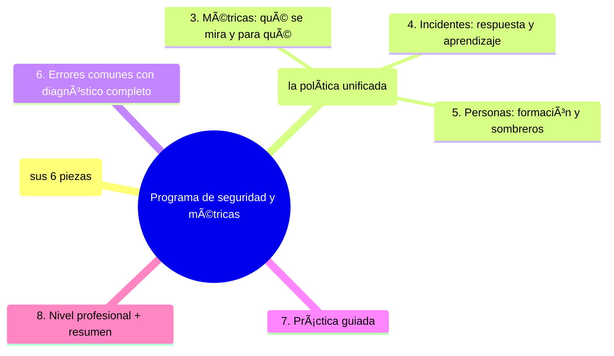

# Programa de seguridad y métricas

## Introducción

Un conjunto de herramientas no es un programa: lo es cuando tiene dueños, puertas definidas, métricas que se miran, respuesta ante incidentes y una costumbre de mejorar. Este capítulo cierra la sección DevSecOps ensamblando todo lo anterior en un programa mínimo viable para cualquier equipo — desde un proyecto con una persona hasta una organización con auditorías — y definiendo qué medir para saber si la seguridad del flujo funciona de verdad.

---\n\n## Autopreguntas de cierre\nSin mirar el material, responde mentalmente y luego compruébalo con este capítulo:\n1. ¿Cuáles son las seis piezas esenciales de un programa mínimo de seguridad y por qué es necesario que todas estén presentes para considerar que se tiene un programa y no solo una colección de herramientas?\n2. ¿Cómo se compone la tabla unificada de puertas y severidad y qué información contiene para guiar las decisiones de seguridad en el flujo?\n3. ¿Cuáles son las cuatro familias de métricas descritas en el capítulo y qué pregunta clave responde cada familia?\n4. ¿Cuál es la estructura común de respuesta a incidentes y qué elementos debe incluir un post-mortem efectivo para generar aprendizaje?\n5. ¿Cómo se integra la formación y la rotación de sombreros en equipos pequeños para garantizar que el conocimiento de seguridad se comparta y no quede en una sola persona?\n6. ¿Qué riesgos existen si se permiten métricas decorativas o post-mortems sin acciones aplicadas, y cómo se mitigan esos riesgos mediante reglas claras?\n\n
## Mapa conceptual de este capítulo



---\n\n## Autopreguntas de cierre\nSin mirar el material, responde mentalmente y luego compruébalo con este capítulo:\n1. ¿Cuáles son las seis piezas esenciales de un programa mínimo de seguridad y por qué es necesario que todas estén presentes para considerar que se tiene un programa y no solo una colección de herramientas?\n2. ¿Cómo se compone la tabla unificada de puertas y severidad y qué información contiene para guiar las decisiones de seguridad en el flujo?\n3. ¿Cuáles son las cuatro familias de métricas descritas en el capítulo y qué pregunta clave responde cada familia?\n4. ¿Cuál es la estructura común de respuesta a incidentes y qué elementos debe incluir un post-mortem efectivo para generar aprendizaje?\n5. ¿Cómo se integra la formación y la rotación de sombreros en equipos pequeños para garantizar que el conocimiento de seguridad se comparta y no quede en una sola persona?\n6. ¿Qué riesgos existen si se permiten métricas decorativas o post-mortems sin acciones aplicadas, y cómo se mitigan esos riesgos mediante reglas claras?\n\n
## 1. El programa mínimo (sus 6 piezas)

```text
1. CONTROLES POR PUERTA (las secciones 19/20/24 —
   lista maestra, sección 04 cap. 04 Paso 2)
   │
2. DUEÑOS (por repo y por control — sección 16 cap.
   06)
   │
3. POLÍTICA DE SEVERIDAD (qué bloquea, qué backlog,
   con qué SLA — cap. 02 punto 2)
   │
4. INVENTARIO (dependencias, integraciones, accesos,
   credenciales — sección 20 cap. 01/03)
   │
5. RESPUESTA (guiones de incidente: secretos,
   suministro, rollback — sección 20 cap. 01 / 22
   cap. 06 / cap. 05 de esta sección)
   │
6. MEJORA CONTINUA (retro con datos + post-mortem con
   control nuevo — sección 23 cap. 01)
```

```text
   │
   └── si una pieza falta, el programa no es un
       programa: es una colección de features (Error 1
       — revisa cuál te falta hoy)
```

---\n\n## Autopreguntas de cierre\nSin mirar el material, responde mentalmente y luego compruébalo con este capítulo:\n1. ¿Cuáles son las seis piezas esenciales de un programa mínimo de seguridad y por qué es necesario que todas estén presentes para considerar que se tiene un programa y no solo una colección de herramientas?\n2. ¿Cómo se compone la tabla unificada de puertas y severidad y qué información contiene para guiar las decisiones de seguridad en el flujo?\n3. ¿Cuáles son las cuatro familias de métricas descritas en el capítulo y qué pregunta clave responde cada familia?\n4. ¿Cuál es la estructura común de respuesta a incidentes y qué elementos debe incluir un post-mortem efectivo para generar aprendizaje?\n5. ¿Cómo se integra la formación y la rotación de sombreros en equipos pequeños para garantizar que el conocimiento de seguridad se comparta y no quede en una sola persona?\n6. ¿Qué riesgos existen si se permiten métricas decorativas o post-mortems sin acciones aplicadas, y cómo se mitigan esos riesgos mediante reglas claras?\n\n
## 2. Puertas y severidad (la política unificada)

```text
TABLA ÚNICA (la que vienes construyendo):
──────────────────────────────────────────────────────
PUERTA        BLOQUEA                  BACKLOG CON SLA
editor        secretos locales         —
PR            secretos, SAST crítico,  warnings,
              deps con CVE alto        días–semanas
main/build    imágenes vulnerables,    medio plazo
              receta fija
staging       DAST crítico, humo       resto
deploy        gate: checks + hallazgos —
              bloqueantes + aprobación
operación     alertas de SLO           post-mortem
```

```text
SLA POR SEVERIDAD (ejemplo — define los tuyos):
   │
   ├── crítico/explotable: horas (mitigar hoy)
   ├── alto: días (7)
   └── medio/bajo: semanas (30)
```

```text
   │
   └── la tabla ES el programa en una página: quien
       llega nuevo la entiende en 10 minutos (Error 2
       si no existe)
```

---\n\n## Autopreguntas de cierre\nSin mirar el material, responde mentalmente y luego compruébalo con este capítulo:\n1. ¿Cuáles son las seis piezas esenciales de un programa mínimo de seguridad y por qué es necesario que todas estén presentes para considerar que se tiene un programa y no solo una colección de herramientas?\n2. ¿Cómo se compone la tabla unificada de puertas y severidad y qué información contiene para guiar las decisiones de seguridad en el flujo?\n3. ¿Cuáles son las cuatro familias de métricas descritas en el capítulo y qué pregunta clave responde cada familia?\n4. ¿Cuál es la estructura común de respuesta a incidentes y qué elementos debe incluir un post-mortem efectivo para generar aprendizaje?\n5. ¿Cómo se integra la formación y la rotación de sombreros en equipos pequeños para garantizar que el conocimiento de seguridad se comparta y no quede en una sola persona?\n6. ¿Qué riesgos existen si se permiten métricas decorativas o post-mortems sin acciones aplicadas, y cómo se mitigan esos riesgos mediante reglas claras?\n\n
## 3. Métricas: qué se mira y para qué

```text
CUATRO FAMILIAS (cada una responde una pregunta):
   │
   ├── ¿detectamos a tiempo?
   │     · % hallazgos descubiertos en PR vs. después
   │     · tiempo medio PR→corrección (por severidad)
   │
   ├── ¿está limpio?
   │     · alertas abiertas y su antigüedad (sección
   │       20 cap. 02/03)
   │     · cobertura de controles (repos con checklist
   │       completa)
   │
   ├── ¿respondemos?
   │     · tiempo de acotación en simulacros (cap. 05
   │       Paso 5)
   │     · MTTR de incidentes (sección 23 cap. 01)
   │
   └── ¿mejoramos?
        · reincidencias (¿mismo post-mortem 2 veces?)
        · excepciones abiertas (bypass, emergencias)
```

```text
REGLA DE ORO (sección 23 cap. 01 Error 3):
   │
   ├── las métricas son BARÓMETRO para conversar en la
   │   retro — no nota, no ranking, no castigo
   │
   └── cada métrica tiene PREGUNTA asociada: si nadie
       hace la pregunta, se retira la métrica
```

```text
   │
   └── empieza con DOS: hallazgos en PR vs. después y
       alertas abiertas > SLA. Con dos que se miren,
       vales más que con veinte decorativos (Error 3)
```

---\n\n## Autopreguntas de cierre\nSin mirar el material, responde mentalmente y luego compruébalo con este capítulo:\n1. ¿Cuáles son las seis piezas esenciales de un programa mínimo de seguridad y por qué es necesario que todas estén presentes para considerar que se tiene un programa y no solo una colección de herramientas?\n2. ¿Cómo se compone la tabla unificada de puertas y severidad y qué información contiene para guiar las decisiones de seguridad en el flujo?\n3. ¿Cuáles son las cuatro familias de métricas descritas en el capítulo y qué pregunta clave responde cada familia?\n4. ¿Cuál es la estructura común de respuesta a incidentes y qué elementos debe incluir un post-mortem efectivo para generar aprendizaje?\n5. ¿Cómo se integra la formación y la rotación de sombreros en equipos pequeños para garantizar que el conocimiento de seguridad se comparta y no quede en una sola persona?\n6. ¿Qué riesgos existen si se permiten métricas decorativas o post-mortems sin acciones aplicadas, y cómo se mitigan esos riesgos mediante reglas claras?\n\n
## 4. Incidentes: respuesta y aprendizaje

```text
RESPUESTA (estructura común — sección 22 cap. 06):
   │
   ├── 1. contener (pausar, revertir, rotar — según el
   │       tipo: guion correspondiente)
   ├── 2. comunicar (canal y dueños — sección 16)
   ├── 3. resolver/verificar (humo, escaneo)
   └── 4. post-mortem SIN CULPA en < 48 h
```

```text
POST-MORTEM QUE SIRVE (plantilla):
   │
   ├── línea temporal (de observabilidad — sección 23
   │   cap. 06)
   ├── causa raíz (sin «el junior clicó» — mira el
   │   control que faltaba)
   ├── acciones: dueño + fecha + tipo de control
   │   (¿qué puerta ahora lo evitaría?)
   └── registro: ¿se aplicó la acción? (si no, se
       repite el incidente — Error 4)
```

```text
   │
   └── el incidente cierra cuando el CONTROL existe,
       no cuando el servicio vuelve (sección 22 cap.
       06 Error 7)
```

---\n\n## Autopreguntas de cierre\nSin mirar el material, responde mentalmente y luego compruébalo con este capítulo:\n1. ¿Cuáles son las seis piezas esenciales de un programa mínimo de seguridad y por qué es necesario que todas estén presentes para considerar que se tiene un programa y no solo una colección de herramientas?\n2. ¿Cómo se compone la tabla unificada de puertas y severidad y qué información contiene para guiar las decisiones de seguridad en el flujo?\n3. ¿Cuáles son las cuatro familias de métricas descritas en el capítulo y qué pregunta clave responde cada familia?\n4. ¿Cuál es la estructura común de respuesta a incidentes y qué elementos debe incluir un post-mortem efectivo para generar aprendizaje?\n5. ¿Cómo se integra la formación y la rotación de sombreros en equipos pequeños para garantizar que el conocimiento de seguridad se comparta y no quede en una sola persona?\n6. ¿Qué riesgos existen si se permiten métricas decorativas o post-mortems sin acciones aplicadas, y cómo se mitigan esos riesgos mediante reglas claras?\n\n
## 5. Personas: formación y sombreros

```text
FORMACIÓN (lo que evita el 60% de los incidentes):
   │
   ├── onboarding: reglas del repo (sección 21 cap.
   │   06), secretos (sección 20 cap. 01), el flujo
   │   (este curso — EMPIEZA-AQUI)
   │
   ├── en el flujo: el PR explica por qué (la
   │   revisión enseña — sección 15 cap. 06)
   │
   └── simulacros: guiones practicados (cap. 05)
```

```text
SOMBREROS (equipos pequeños — sección 24 cap. 01):
   │
   ├── la «seguridad» rota entre personas con
   │   checklist y calendario
   │
   └── el traspaso del sombrero es un entregable: la
       lista maestra se lee (Error 5 si vive en una
       cabeza)
```

```text
   │
   └── cultura: reportar un error propio rápido es
       premiado; ocultarlo es el problema (sección 00
       / 16)
```

---\n\n## Autopreguntas de cierre\nSin mirar el material, responde mentalmente y luego compruébalo con este capítulo:\n1. ¿Cuáles son las seis piezas esenciales de un programa mínimo de seguridad y por qué es necesario que todas estén presentes para considerar que se tiene un programa y no solo una colección de herramientas?\n2. ¿Cómo se compone la tabla unificada de puertas y severidad y qué información contiene para guiar las decisiones de seguridad en el flujo?\n3. ¿Cuáles son las cuatro familias de métricas descritas en el capítulo y qué pregunta clave responde cada familia?\n4. ¿Cuál es la estructura común de respuesta a incidentes y qué elementos debe incluir un post-mortem efectivo para generar aprendizaje?\n5. ¿Cómo se integra la formación y la rotación de sombreros en equipos pequeños para garantizar que el conocimiento de seguridad se comparta y no quede en una sola persona?\n6. ¿Qué riesgos existen si se permiten métricas decorativas o post-mortems sin acciones aplicadas, y cómo se mitigan esos riesgos mediante reglas claras?\n\n
## 6. Errores comunes con diagnóstico completo

### Error 1: colección de herramientas sin programa

**Qué ocurrió:** 6 productos activos, ninguno con dueño; nadie sabía qué bloqueaba qué.

**Por qué:** se compraron piezas, no se diseñó el programa (punto 1).

**Cómo comprobarlo:** pregunta por cada una de las 6 piezas: ¿existe y quién la lleva?

**Opciones:** completar la pieza que falte empezando por dueños y política.

**Riesgos:** cartera cara e inútil.

**Solución:** las 6 piezas (punto 1).

**Cómo se evita:** revisión anual del programa con la lista.

---\n\n## Autopreguntas de cierre\nSin mirar el material, responde mentalmente y luego compruébalo con este capítulo:\n1. ¿Cuáles son las seis piezas esenciales de un programa mínimo de seguridad y por qué es necesario que todas estén presentes para considerar que se tiene un programa y no solo una colección de herramientas?\n2. ¿Cómo se compone la tabla unificada de puertas y severidad y qué información contiene para guiar las decisiones de seguridad en el flujo?\n3. ¿Cuáles son las cuatro familias de métricas descritas en el capítulo y qué pregunta clave responde cada familia?\n4. ¿Cuál es la estructura común de respuesta a incidentes y qué elementos debe incluir un post-mortem efectivo para generar aprendizaje?\n5. ¿Cómo se integra la formación y la rotación de sombreros en equipos pequeños para garantizar que el conocimiento de seguridad se comparta y no quede en una sola persona?\n6. ¿Qué riesgos existen si se permiten métricas decorativas o post-mortems sin acciones aplicadas, y cómo se mitigan esos riesgos mediante reglas claras?\n\n
### Error 2: política que nadie puede citar

**Qué ocurrió:** ante un hallazgo, cada quien interpretó la severidad a su manera.

**Por qué:** sin tabla unificada (punto 2).

**Cómo comprobarlo:** dile a un miembro: «¿qué bloquea el PR?» — si duda, no existe.

**Opciones:** escribir la tabla (punto 2), publicarla, usarla en la retro.

**Riesgos:** gates arbitrarios (sección 22 cap. 04 Error 4).

**Solución:** una página citable (punto 2).

**Cómo se evita:** revisarla en cada cambio de control.

---\n\n## Autopreguntas de cierre\nSin mirar el material, responde mentalmente y luego compruébalo con este capítulo:\n1. ¿Cuáles son las seis piezas esenciales de un programa mínimo de seguridad y por qué es necesario que todas estén presentes para considerar que se tiene un programa y no solo una colección de herramientas?\n2. ¿Cómo se compone la tabla unificada de puertas y severidad y qué información contiene para guiar las decisiones de seguridad en el flujo?\n3. ¿Cuáles son las cuatro familias de métricas descritas en el capítulo y qué pregunta clave responde cada familia?\n4. ¿Cuál es la estructura común de respuesta a incidentes y qué elementos debe incluir un post-mortem efectivo para generar aprendizaje?\n5. ¿Cómo se integra la formación y la rotación de sombreros en equipos pequeños para garantizar que el conocimiento de seguridad se comparta y no quede en una sola persona?\n6. ¿Qué riesgos existen si se permiten métricas decorativas o post-mortems sin acciones aplicadas, y cómo se mitigan esos riesgos mediante reglas claras?\n\n
### Error 3: dashboard de 20 métricas sin preguntas

**Qué ocurrió:** nadie miraba nada; las decisiones seguían a intuición.

**Por qué:** métrica sin pregunta (punto 3 / sección 23 cap. 01 Error 6).

**Cómo comprobarlo:** última decisión motivada por la seguridad del dashboard.

**Opciones:** reducir a dos con preguntas; retirar el resto.

**Riesgos:** parálisis por vanidad.

**Solución:** pregunta → métrica → acción (punto 3).

**Cómo se evita:** regla «cada métrica con dueño de pregunta».

---\n\n## Autopreguntas de cierre\nSin mirar el material, responde mentalmente y luego compruébalo con este capítulo:\n1. ¿Cuáles son las seis piezas esenciales de un programa mínimo de seguridad y por qué es necesario que todas estén presentes para considerar que se tiene un programa y no solo una colección de herramientas?\n2. ¿Cómo se compone la tabla unificada de puertas y severidad y qué información contiene para guiar las decisiones de seguridad en el flujo?\n3. ¿Cuáles son las cuatro familias de métricas descritas en el capítulo y qué pregunta clave responde cada familia?\n4. ¿Cuál es la estructura común de respuesta a incidentes y qué elementos debe incluir un post-mortem efectivo para generar aprendizaje?\n5. ¿Cómo se integra la formación y la rotación de sombreros en equipos pequeños para garantizar que el conocimiento de seguridad se comparta y no quede en una sola persona?\n6. ¿Qué riesgos existen si se permiten métricas decorativas o post-mortems sin acciones aplicadas, y cómo se mitigan esos riesgos mediante reglas claras?\n\n
### Error 4: post-mortems sin acciones aplicadas

**Qué ocurrió:** cien documentos y las mismas causas repitiéndose.

**Por qué:** acciones sin dueño/fecha ni verificación (punto 4).

**Cómo comprobarlo:** lista de acciones abiertas y su antigüedad.

**Opciones:** tracker de acciones con cierre verificado; revisión mensual.

**Riesgos:** aprendizaje de ficción.

**Solución:** cierra cuando el control existe (punto 4).

**Cómo se evita:** la revisión mensual los cuenta como métrica «mejora» (punto 3).

---\n\n## Autopreguntas de cierre\nSin mirar el material, responde mentalmente y luego compruébalo con este capítulo:\n1. ¿Cuáles son las seis piezas esenciales de un programa mínimo de seguridad y por qué es necesario que todas estén presentes para considerar que se tiene un programa y no solo una colección de herramientas?\n2. ¿Cómo se compone la tabla unificada de puertas y severidad y qué información contiene para guiar las decisiones de seguridad en el flujo?\n3. ¿Cuáles son las cuatro familias de métricas descritas en el capítulo y qué pregunta clave responde cada familia?\n4. ¿Cuál es la estructura común de respuesta a incidentes y qué elementos debe incluir un post-mortem efectivo para generar aprendizaje?\n5. ¿Cómo se integra la formación y la rotación de sombreros en equipos pequeños para garantizar que el conocimiento de seguridad se comparta y no quede en una sola persona?\n6. ¿Qué riesgos existen si se permiten métricas decorativas o post-mortems sin acciones aplicadas, y cómo se mitigan esos riesgos mediante reglas claras?\n\n
### Error 5: el programa en una cabeza

**Qué ocurrió:** se fue la persona de seguridad y el programa quedó en PDFs viejos.

**Por qué:** sin sombreros, checklists ni traspaso (punto 5).

**Cómo comprobarlo:** si la persona no está, ¿quién sabe citar la política?

**Opciones:** todo por escrito y con rotación real del sombrero (calendario).

**Riesgos:** amnesia institucional.

**Solución:** memoria externa (punto 1/5).

**Cómo se evita:** el programa es un repositorio — como este curso.

---\n\n## Autopreguntas de cierre\nSin mirar el material, responde mentalmente y luego compruébalo con este capítulo:\n1. ¿Cuáles son las seis piezas esenciales de un programa mínimo de seguridad y por qué es necesario que todas estén presentes para considerar que se tiene un programa y no solo una colección de herramientas?\n2. ¿Cómo se compone la tabla unificada de puertas y severidad y qué información contiene para guiar las decisiones de seguridad en el flujo?\n3. ¿Cuáles son las cuatro familias de métricas descritas en el capítulo y qué pregunta clave responde cada familia?\n4. ¿Cuál es la estructura común de respuesta a incidentes y qué elementos debe incluir un post-mortem efectivo para generar aprendizaje?\n5. ¿Cómo se integra la formación y la rotación de sombreros en equipos pequeños para garantizar que el conocimiento de seguridad se comparta y no quede en una sola persona?\n6. ¿Qué riesgos existen si se permiten métricas decorativas o post-mortems sin acciones aplicadas, y cómo se mitigan esos riesgos mediante reglas claras?\n\n
## 7. Práctica guiada

### Objetivo

Montar el programa mínimo de tu proyecto: política, métricas y respuesta.

### Paso 1: las 6 piezas (auditoría)

```text
Marca estado:  sí existe · parcial · falta
   │
   1 controles por puerta   4 inventarios
   2 dueños                 5 guiones de respuesta
   3 política severidad/SLA 6 mejora continua
```

1. Empieza por lo que falta y tiene mayor riesgo.

### Paso 2: la tabla unificada

1. Escribe la tabla del punto 2 en `docs/seguridad.md` (o `docs/seguridad-entrega.md` si ya lo tienes — fusiona).

### Paso 3: dos métricas

1. Elige: (a) hallazgos en PR vs. después y (b) alertas abiertas > SLA.
2. Anota la línea base de hoy — aunque sea «0 medido, empieza mañana».

### Paso 4: guion de incidente maduro

1. Ten al menos dos guiones: secretos (sección 20 cap. 01) y suministro (cap. 05).
2. Programa un simulacro en el calendario (fecha y responsable).

### Paso 5: post-mortem de mentira real

1. Toma un «incidente» pequeño de la vida real del proyecto (un CI rojo de horas, una dependencia que rompió) y escribe su post-mortem con la plantilla del punto 4 — incluida la acción con dueño.

### Paso 6: publica y cita

```markdown
Del programa, en el README del repo:
- Controles y política → docs/seguridad.md
- Incidentes → docs/incidentes/ (guiones)
- Dueños → tabla de CODEOWNERS/documento
- Las 2 métricas → enlace o página
```

### Resultado esperado

Auditoría de las 6 piezas con una cerrada, política citable, dos métricas con línea base y simulacro en calendario.

### Ejercicio de transferencia
Aplica los principios de un programa de seguridad a un proceso de gestión de un proyecto de construcción. Define las seis piezas del programa (controles por fase, dueños, política de severidad, inventario de recursos, respuesta a incidentes, mejora continua) y cómo se aplicarían en cada etapa (diseño, licitación, construcción, puesta en marcha). Entrega un documento que describa el programa y sus métricas clave.
### Conclusión esperada

El programa es lo que sobrevive a la prisa: cuando la política se cita, las métricas se miran y los guiones se practican, la seguridad se volvió una propiedad del equipo — no de una herramienta.

---\n\n## Autopreguntas de cierre\nSin mirar el material, responde mentalmente y luego compruébalo con este capítulo:\n1. ¿Cuáles son las seis piezas esenciales de un programa mínimo de seguridad y por qué es necesario que todas estén presentes para considerar que se tiene un programa y no solo una colección de herramientas?\n2. ¿Cómo se compone la tabla unificada de puertas y severidad y qué información contiene para guiar las decisiones de seguridad en el flujo?\n3. ¿Cuáles son las cuatro familias de métricas descritas en el capítulo y qué pregunta clave responde cada familia?\n4. ¿Cuál es la estructura común de respuesta a incidentes y qué elementos debe incluir un post-mortem efectivo para generar aprendizaje?\n5. ¿Cómo se integra la formación y la rotación de sombreros en equipos pequeños para garantizar que el conocimiento de seguridad se comparta y no quede en una sola persona?\n6. ¿Qué riesgos existen si se permiten métricas decorativas o post-mortems sin acciones aplicadas, y cómo se mitigan esos riesgos mediante reglas claras?\n\n
## 8. Nivel profesional + resumen

### 8.1. El programa a escala

```text
   │
   ├── gobierno: dueños por repo, comité/foro mensual
   │   de seguridad-entrega (nombre simple, pero foro)
   │
   ├── métricas consolidadas en un tablero único con
   │   preguntas (punto 3)
   │
   ├── simulacros en calendario: secretos, suministro,
   │   rollback (sección 22 cap. 06 / cap. 05)
   │
   ├── auditoría interna anual: ¿las 6 piezas? ¿las
   │   métricas se usan? (Error 1 — sección 20/24)
   │
   ├── cumplimiento (mención): marcos y regulaciones
   │   piden EXACTAMENTE esto: política, evidencias,
   │   métricas y mejora — el programa bien hecho
   │   documenta su evidencia
   │
   └── métricas de programa: acciones de post-mortem
       cerradas a tiempo; % repos con checklist
       completa; tiempo de acotación
```

### 8.2. Resumen

En este capítulo aprendiste que:

* programa = controles + dueños + política + inventarios + respuesta + mejora — las seis piezas o no es programa;
* la tabla de puertas y severidad con SLA es la página que todo el mundo debe poder citar;
* métricas por familia (detectar, limpiar, responder, mejorar), empezando por dos con preguntas;
* incidentes: contener → comunicar → resolver → post-mortem sin culpa con acción verificada;
* personas: onboarding, revisión que enseña, simulacros y sombreros con traspaso;
* los errores típicos (colección sin programa, política citable no, métricas decorativas, post-mortems de ficción, programa en una cabeza) se previenen con estructura y calendario;
* a nivel profesional: gobierno, auditoría interna y evidencia para cumplimiento.

La idea principal es:

> **Un programa de seguridad es lo que permanece cuando nadie está mirando: política que se cita, métricas que se preguntan y guiones que ya se han practicado — todo lo demás es una herramienta esperando su incidente.**

---\n\n## Autopreguntas de cierre\nSin mirar el material, responde mentalmente y luego compruébalo con este capítulo:\n1. ¿Cuáles son las seis piezas esenciales de un programa mínimo de seguridad y por qué es necesario que todas estén presentes para considerar que se tiene un programa y no solo una colección de herramientas?\n2. ¿Cómo se compone la tabla unificada de puertas y severidad y qué información contiene para guiar las decisiones de seguridad en el flujo?\n3. ¿Cuáles son las cuatro familias de métricas descritas en el capítulo y qué pregunta clave responde cada familia?\n4. ¿Cuál es la estructura común de respuesta a incidentes y qué elementos debe incluir un post-mortem efectivo para generar aprendizaje?\n5. ¿Cómo se integra la formación y la rotación de sombreros en equipos pequeños para garantizar que el conocimiento de seguridad se comparta y no quede en una sola persona?\n6. ¿Qué riesgos existen si se permiten métricas decorativas o post-mortems sin acciones aplicadas, y cómo se mitigan esos riesgos mediante reglas claras?\n\n
## Próximo paso

Has completado la sección de DevSecOps.

Continúa con el cierre:

[`README.md`](README.md)


