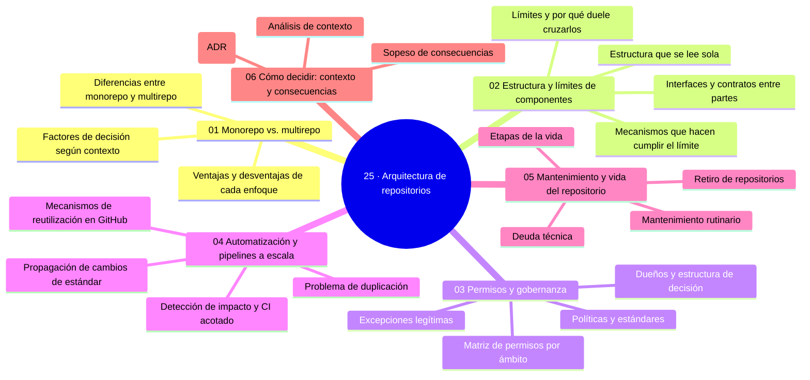

# 25 — Arquitectura de repositorios

## Bienvenido a esta sección

Hasta aquí el curso ha construido prácticamente; esta sección enseña a **decidir dónde y cómo vive todo eso**: monorepo o multirepo con criterio (no con dogma), estructuras que se leen, límites entre componentes que se verifican, permisos y gobernanza que gobiernan sin asfixiar, automatización a escala sin duplicar, y el mantenimiento y retiro que sostienen la vida del repositorio. La sección entera evita la respuesta única: su materia prima es tu contexto.

## En esta sección estudiarás

* monorepo y multirepo como consecuencias firmadas, no como religiones;
* estructura y límites de componentes: interfaces, mecanismos y estructura heredada;
* permisos y gobernanza: matriz, políticas, dueños y excepciones legítimas;
* automatización y pipelines a escala: fuentes únicas, impacto y propagación;
* mantenimiento y ciclo de vida completo, incluido el retiro;
* el marco de decisión: contexto, tabla de consecuencias y registro (ADR).

## Objetivos de aprendizaje

Al terminar esta sección serás capaz de:

* decidir entre monorepo y multirepo con el marco de contexto, no con dogma;
* diseñar estructura y límites de componentes como contratos (interfaces y mecanismos);
* definir la matriz de permisos y gobernanza con excepciones legítimas y documentadas;
* escalar la automatización sin duplicar: fuentes únicas, análisis de impacto y propagación;
* gestionar el ciclo de vida completo del repositorio, incluido el retiro;
* documentar decisiones de arquitectura con ADRs.

## Mapa conceptual

---

## ¿Qué aprenderás en esta sección?

1. [`01-monorepo-vs-multirepo.md`](01-monorepo-vs-multirepo.md) — la pregunta con marco de factores.
2. [`02-estructura-y-limites-de-componentes.md`](02-estructura-y-limites-de-componentes.md) — el árbol y las fronteras como contrato.
3. [`03-permisos-y-gobernanza.md`](03-permisos-y-gobernanza.md) — quién gobierna las reglas.
4. [`04-automatizacion-y-pipelines-a-escala.md`](04-automatizacion-y-pipelines-a-escala.md) — cambiar el estándar una vez.
5. [`05-mantenimiento-y-vida-del-repositorio.md`](05-mantenimiento-y-vida-del-repositorio.md) — etapas, deuda y retiro.
6. [`06-como-decidir-el-contexto.md`](06-como-decidir-el-contexto.md) — el oficio de decidir y registrarlo.

## Cómo estudiar esta sección

Estudia con tu proyecto real a la vista: cada capítulo pide contexto propio (matriz de factores, árbol, dueños, calendario). Si vienes de las secciones 22–24, encontrarás la misma disciplina de proceso aplicada ahora a la forma del repositorio.

## Referencias

* Slauson, A. et al. — «Monorepos: Improving Developer Productivity» (Microsoft Research, 2017).
* Torvalds, L. — «A note on code for fork()ers» (2000).
* Nygard, M. — «Documenting architectural decisions» (2011).
* trunkbaseddevelopment.com — pautas de monorepo.

---
## Checkpoint 25 — Comprobación obligatoria

Antes de avanzar a `26-nivel-senior/`, demuestra que puedes (en un repositorio de práctica real):

1. **Decidir** entre monorepo y multirepo para un proyecto dado usando el marco de contexto (factores como tamaño, equipo, frecuencia de releases).
2. **Diseñar** estructura de componentes y definir interfaces que limiten el acoplamiento.
3. **Crear** una matriz de permisos por ámbito (ej. lectura, escritura, admin) y asignar roles.
4. **Definir** una política de automatización compartida y describir cómo propagar un cambio de estándar.
5. **Elaborar** un plan de mantenimiento que incluya revisión de deuda técnica y criterios de retiro.
6. **Registrar** una decisión de arquitectura usando un ADR (Architecture Decision Record).

Si puedes hacerlo **sin mirar instrucciones**, el checkpoint está cerrado.

## Autopreguntas de cierre

Sin mirar el material, responde mentalmente y luego compruébalo con los capítulos de la sección:

1. ¿Qué tres factores suelen inclinar la decisión hacia monorepo?
2. ¿Qué convierte un límite entre componentes en un «contrato» y no en una carpeta?
3. ¿Cuándo es legítimo saltarse una regla de gobernanza y qué se deja escrito?
4. ¿Qué se hace al retirar un repositorio y qué nunca se hace?
5. ¿Cómo afecta la elección entre monorepo y multirepo a la visibilidad de dependencias y al riesgo de conflictos de versiones?
6. ¿Qué mecanismos en GitHub (como CODEOWNERS, protecciones de rama o workflows reutilizables) ayudan a hacer cumplir los límites de componentes sin crear cuellos de botella?
7. ¿Por qué es importante documentar excepciones a las políticas de gobernanza y qué información debe incluir ese registro?
8. Al planificar el retiro de un repositorio, ¿qué pasos debes tomar para asegurar que los usuarios dependientes tengan tiempo suficiente para migrar y qué comunicaciones son esenciales?

---

## Próximo paso

Cuando termines los seis capítulos, continúa con la siguiente sección:

[`../26-nivel-senior/`](../26-nivel-senior/)
