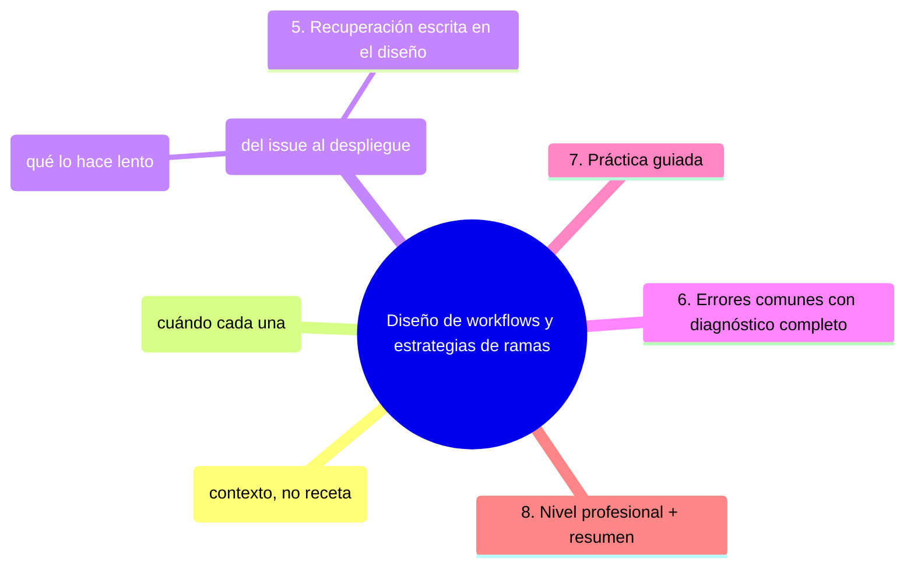
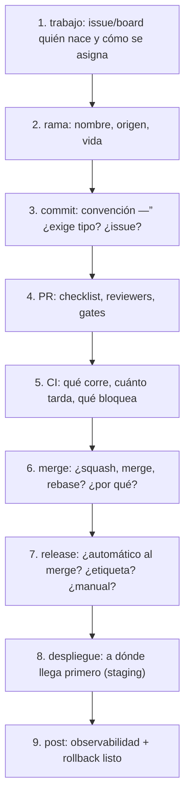

# Diseño de workflows y estrategias de ramas

## Introducción

El paso de nivel no consiste en conocer más comandos: consiste en **diseñar el flujo completo de un equipo** —” desde qué rama nace hasta qué pasa en producción —” eligiendo cada pieza por contexto, no por costumbre. Este capítulo trata workflow y estrategia de ramas como una sola decisión: la forma del flujo determina cómo se revisa, se prueba, se libera y se recupera un equipo. Pasa en revista todo lo estudiado (secciones 07, 17, 19, 22) y enseña a escoger con criterio senior.

---

## Mapa conceptual de este capítulo


---

## 1. La pregunta senior (contexto, no receta)

```text
EL CAMBIO DE PREGUNTA (etapa 26 —” lo guía todo):
    │
    ├── antes: «¿Qué comando uso?»
    │
    ┼”── ahora: «¿Qué ESTRATEGIA resuelve mejor este
        problema para ESTE equipo y ESTE proyecto?»
```

```text
FACTORES QUE DECIDEN EL FLUJO:
    │
    ├── ritmo de release: ¿a diario · semanal · mensual
    │   · por evento? (sección 17/22)
    ├── riesgo: ¿qué pasa si algo malo llega a
    │   producción? (fintech ≠ blog)
    ├── tamaño del equipo y solapamiento de ramas
    ├── disciplina real del equipo (Error 1: elegir el
    │   flujo más estricto que el equipo NO va a
    │   cumplir)
    ┼”── automatización disponible: el flujo solo escala
        si el CI lo sostiene (sección 19/22)
```

```text
    │
    ┼”── la estrategia es una HIPÜ“TESIS con contexto —”
        se escribe, se prueba y se revisa (Error 2 si
        nadie sabe cuál es la «oficial»)
```

---

## 2. Las estrategias como familia (cuándo cada una)

```text
FAMILIA (sección 17 —” revisada con «cuándo»):
    │
    ├── trunk/development directo: fluye rápido,
    │   exige CI fortísimo, feature flags, equipo
    │   disciplinado y releases frecuentes (Error 3 si
    │   se adopta sin esa base)
    │
    ├── una rama de desarrollo (dev) + ramas de feature:
    │   equipo medio que quiere integración continua
    │   sin sorpresas de main
    │
    ├── release branch (release/X): releases predecibles
    │   y estables —” clásico de versionado mensual/semanal
    │   (sección 17 cap. 05)
    │
    ├── ramas por release cortas (release → hotfix →
    │   volver): mantenimiento de versiones viejas
    │   (sección 17 cap. 06)
    │
    ┼”── GitFlow completo: varios productos con versiones
        largas mantenidas —” hoy minoritario (Error 4 si
        se copia por completitud, no por necesidad)
```

```text
SEÅAL DE ELECCIÜ“N:
    │
    ├── «liberamos cuando está listo y a menudo» →
    │   trunk/flags o dev simple
    ├── «liberamos cada jueves y hay que arreglar lo
    │   anterior» → release branch
    ┼”── «mantenemos 3 versiones soportadas» → ramas de
        mantenimiento (sección 17 cap. 06)
```

```text
    │
    ┼”── la elección correcta es la M܁S SIMPLE que
        cubre tu riesgo (Error 4: complejidad heredada
        de un problema que no tienes)
```

---

## 3. Diseñar el workflow completo (del issue al despliegue)


```text
    │
    ┼”── el workflow se DIBUJA (diagrama en docs) y se
        cita: «¿dónde está escrito nuestro flujo?» es
        una pregunta senior (Error 5 si la respuesta es
        «como siempre se hizo»)
```

---

## 4. Calidad del flujo (qué lo hace lento o frágil)

```text
MÆTRICAS DEL FLUJO (sección 24 cap. 06 —” solo lo
medido se mejora):
    │
    ├── lead time: issue → producción
    ├── tiempo de PR abierto a revisión (Error 5 de
    │   sección 25 cap. 05)
    ├── duración de CI por PR (Error 5 sección 04 de
    │   25)
    ┼”── frecuencia de releases y su tasa de fallo
```

```text
S܍NTOMAS Y REMEDIOS (senior = diagnosticar):
    │
    ├── PRs grandes y lentos → parte el trabajo (sección
    │   15 cap. 01 Error 1) + límite de abiertos
    ├── CI rojo constante → estabilizar antes de añadir
    │   puertas (sección 19 cap. 06)
    ├── merges conflictivos → integrar más a menudo
    │   (Error 3 —” pull frecuente, sección 17 cap. 04)
    ┼”── releases manuales y heroicos → automatizar
        release/rollback (sección 22 cap. 06)
```

```text
    │
    ┼”── el senior no añade proceso: QUITA FRICCIÜ“N de
        lo que ya funciona y ENDURECE donde rompe (Error
        6 si la respuesta a todo es «más reglas»)
```

---

## 5. Recuperación escrita en el diseño

```text
TODO FLUJO DISEÅADO TRAE SU VUELTA ATR܁S:
    │
    ├── «¿cómo se revierte un release malo?» —”
    │   respuesta escrita y probada (sección 22 cap.
    │   06 —” Error 7 si no existe)
    │
    ├── «¿cómo se recupera main si alguien hace
    │   daño?» —” protección + reset coordinado (sección
    │   08/16)
    │
    ┼”── «¿cómo se recupera el repo si desaparece todo?»
        —” respaldo y espejo (punto siguiente: sección 04
        Error 5, cap. 03 disaster)
```

```text
    │
    ┼”── un flujo sin plan de vuelta es una autopista
        sin barandilla: hasta que hace falta (Error 7)
```

---

## 6. Errores comunes con diagnóstico completo

### Error 1: estrategia más estricta que el equipo

**Qué ocurrió:** GitFlow completo adoptado; en dos meses todos trabajaban en main «para no frenar».

**Por qué:** se eligió por teoría, no por disciplina real (punto 1).

**Cómo comprobarlo:** ¿se cumplen los pasos del flujo en los últimos 20 PRs?

**Opciones:** simplificar a la estrategia que S܍ se cumple; o formar/automatizar hasta poder sostener la estricta.

**Riesgos:** el flujo oficial deja de reflejar la realidad (peor que ninguno).

**Solución:** la más simple que cubra el riesgo (punto 1/2).

**Cómo se evita:** auditar disciplina antes de elegir (punto 1).

---

### Error 2: nadie sabe cuál es la estrategia oficial

**Qué ocurrió:** tres patrones de rama conviviendo según quién abría el PR.

**Por qué:** no se escribió ni comunicó (punto 1/3).

**Cómo comprobarlo:** pregunta a 3 miembros: «¿de dónde sale tu rama?» —” respuestas distintas = Error.

**Opciones:** escribir el flujo en un diagrama de una página; enlazarlo en el PR template.

**Riesgos:** inconsistencia y conflictos evitables.

**Solución:** flujo dibujado y citado (punto 3).

**Cómo se evita:** la plantilla de repo lo incluye (sección 18).

---

### Error 3: trunk directo sin base

**Qué ocurrió:** sin feature flags ni CI fortaleza, cada merge «experimental» rompía a todos.

**Por qué:** se copió el modelo sin sus prerrequisitos (punto 2).

**Cómo comprobarlo:** ¿hay flags? ¿CI < presupuesto y estable? ¿equipo entrenado?

**Opciones:** añadir la base (flags, CI) o retroceder a rama de integración.

**Riesgos:** producción como sala de pruebas.

**Solución:** prerrequisitos primero (punto 2).

**Cómo se evita:** checklist de adopción de estrategia.

---

### Error 4: GitFlow «porque es el completo»

**Qué ocurrió:** proyecto con release quincenal heredó release/hotfix/develop/feature —” cuatro ramas vivas para dos personas.

**Por qué:** complejidad copiada de un problema inexistente (punto 2).

**Cómo comprobarlo:** ¿cuántas ramas «de proceso» viven hoy? ¿qué problema resuelve cada una?

**Opciones:** eliminar las que no resuelven; simplificar (sección 17 cap. 03 Error 1).

**Riesgos:** coste permanente en coordinación.

**Solución:** complejidad proporcional al riesgo (punto 2).

**Cómo se evita:** revisión anual del flujo con la etapa y ritmo reales.

---

### Error 5: workflow no documentado

**Qué ocurrió:** el flujo existía solo en la cabeza del líder; al irse, el equipo reinventó.

**Por qué:** nada escrito (punto 3).

**Cómo comprobarlo:** ¿dónde está el diagrama? URL o no existe.

**Opciones:** escribirlo hoy con el recorrido del punto 3.

**Riesgos:** pérdida de continuidad.

**Solución:** recorrido completo dibujado (punto 3).

**Cómo se evita:** revisar el diagrama cuando cambia el flujo (Error 2).

---

### Error 6: «más reglas» como única respuesta

**Qué ocurrió:** cada incidente añadía una aprobación; los PRs tardaron días en empezar.

**Por qué:** se confundió endurecer con frenar (punto 4).

**Cómo comprobarlo:** ¿se midió el efecto en lead time tras cada regla?

**Opciones:** medir; retirar reglas sin efecto; automatizar lo automatizable (sección 23 cap. 01).

**Riesgos:** burocracia lenta y bypass.

**Solución:** quitar fricción, endurecer donde rompe (punto 4).

**Cómo se evita:** toda regla nueva con métrica y fecha de revisión (sección 24 cap. 06).

---

### Error 7: flujo sin plan de vuelta

**Qué ocurrió:** un release malo obligó a improvisar un hotfix en caliente sin probar rollback.

**Por qué:** la recuperación no estaba en el diseño (punto 5).

**Cómo comprobarlo:** «¿cómo se revierte?» —” ¿respuesta escrita y probada alguna vez?

**Opciones:** documentar el procedimiento y practicarlo en simulacro (sección 24 cap. 05).

**Riesgos:** improvisación bajo presión.

**Solución:** vuelta atrás escrita (punto 5).

**Cómo se evita:** checklist de diseño de flujo con el paso 9 obligatorio (punto 3).

---

## 7. Práctica guiada

### Objetivo

Diseñar (o rediseñar) el flujo completo de TU equipo con criterio senior.

### Paso 1: contexto

```text
Tu equipo/proyecto:
    │
    ├── frecuencia de release real: ____
    ├── riesgo de cada release: ____
    ├── disciplina actual: ____
    ┼”── automatización: ____
```

### Paso 2: elige estrategia

1. Con la familia del punto 2, elige la M܁S SIMPLE que cubra tu riesgo y anota por qué (Error 2 —” queda escrito).

### Paso 3: dibuja el recorrido

1. Completa los 9 pasos del punto 3 para tu equipo. ¿Dónde duele hoy?

### Paso 4: métricas

1. Anota la línea base: lead time, PR abierto a revisión, CI por PR, frecuencia de release (Error 6 prevención).

### Paso 5: la vuelta atrás

1. Escribe: «Release malo → cómo se revierte» (procedimiento concreto con tus comandos/acciones).

### Paso 6: publica

1. Diagrama + estrategia + vuelta atrás en `docs/flujo.md`, enlazado desde README y PR template.

### Resultado esperado

Flujo elegido por contexto y escrito: 9 pasos, métricas con línea base y rollback probado en papel.

### Conclusión esperada

El flujo senior no es el más famoso: es el que el equipo puede cumplir, medir y revertir —” y que cualquiera puede leer en un diagrama sin preguntarle a nadie.

### Ejercicio de transferencia
Toma el flujo de otro proyecto conocido (por ejemplo, un proyecto de código abierto que uses) y analízalo usando los mismos nueve pasos: identifica quién nace el trabajo, cómo se nombran las ramas, etc. Entregable: un documento que describa el flujo de ese proyecto y señale una mejora que aplicarías con criterio senior.

---

## 8. Nivel profesional + resumen

### 8.1. Flujos a escala

```text
    │
    ├── estandarizar el NÜšCLEO (rama base, PR, CI,
    │   release) y dejar margen por tipo de componente
    │   (piso y margen —” sección 25 cap. 04 punto 5)
    │
    ├── estrategia documentada POR EQUIPO en su fase
    │   (crecimiento vs. mantenimiento —” sección 25
    │   cap. 05 punto 1)
    │
    ├── métricas del flujo en cartera: lead time y
    │   frecuencia por repo (Error 6 prevención a
    │   escala)
    │
    ├── releases como producto: calendario, notas,
    │   rollback (sección 17 cap. 06 / 22 cap. 06)
    │
    ┼”── revisión semestral del flujo: ¿sigue cubriendo
        el riesgo actual? (punto 1 —” contexto cambió)
```

### 8.2. Resumen

En este capítulo aprendiste que:

* la pregunta senior es de contexto: estrategia para ESTE equipo y proyecto, no receta;
* la familia de estrategias (trunk, dev, release, mantenimiento, GitFlow) se elige por ritmo, riesgo y disciplina —” la más simple que cubra;
* el workflow completo tiene 9 pasos, del issue a la observabilidad, dibujados y citados;
* la calidad del flujo se mide (lead time, PRs, CI, releases) y se mejora quitando fricción y endureciendo donde rompe;
* la recuperación (rollback del release, de main, del repo) es parte del diseño, no un apéndice;
* los errores típicos (estrategia imposible, flujo oral, trunk sin base, GitFlow copiado, workflow invisible, «más reglas», vuelta atrás improvisada) se previenen con contexto, documento y métricas;
* a nivel profesional: núcleo estandarizado con margen y revisión semestral.

La idea principal es:

> **Diseñar un flujo no es elegir ramas: es decidir cómo este equipo concreto convierte trabajo en valor confiable —” y cómo vuelve a estar confiable cuando algo sale mal.**

---


## Autopreguntas de cierre
Sin mirar el material, responde mentalmente y luego compruébalo con este capítulo:
1. ¿Cuál es la pregunta senior que guía el diseño de workflows y estrategias de ramas?
2. ¿Cómo se elige la estrategia de ramificación más apropiada para un equipo?
3. ¿Qué componentes forman el flujo completo desde el issue hasta el despliegue?
4. ¿Cómo se mide la calidad del flujo y qué se hace para mejorarla?
5. ¿Por qué es importante incluir el plan de vuelta (rollback) en el diseño del flujo?
6. ¿Cómo se evita caer en errores comunes como elegir una estrategia sin base real?

## Próximo paso

Ya diseñas flujos con criterio.

Ahora las dos prácticas que lo sostienen: revisar código y gestionar releases.

Continúa con:

[`02-revision-de-codigo-y-gestion-de-releases.md`](02-revision-de-codigo-y-gestion-de-releases.md)
