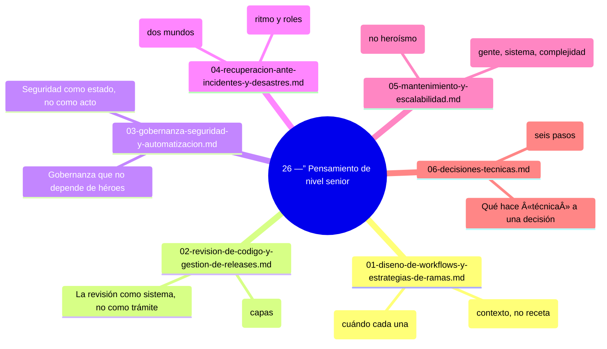

# 26 —” Pensamiento de nivel senior

## Bienvenido a esta sección

Has estudiado comandos, flujos, seguridad y operación; aquí todo se ensambla en una sola capacidad: **decidir mejor con contexto**. La pregunta cambia de «¿qué comando uso?» a «¿qué estrategia resuelve mejor este problema para este equipo y este proyecto?». Esta sección no agrega herramientas nuevas: reordena todo lo aprendido bajo la mirada de quien es responsable del conjunto —” flujo, calidad, gobierno, recuperación, largo plazo y decisiones.
## Mapa conceptual de este capítulo

## En esta sección estudiarás

* diseño de workflows y estrategias de ramas elegidas por contexto;
* revisión de código por capas y releases como proceso maduro;
* gobernanza, seguridad y automatización que no dependen de héroes;
* respuesta a incidentes y preparación ante desastres con ensayo;
* mantenimiento presupuestado y las tres escalas de crecimiento;
* el método de decisión técnica: seis pasos, registro y reversibilidad.

## Objetivos de aprendizaje

Al terminar esta sección serás capaz de:

* diseñar workflows y estrategias de ramas elegidas por contexto y no por moda;
* revisar código por capas y gestionar releases como proceso maduro con dueño;
* construir gobernanza, seguridad y automatización que no dependan de héroes;
* responder a incidentes y prepararse ante desastres con ensayos previos;
* planificar mantenimiento presupuestado y las tres escalas de crecimiento;
* aplicar el método de decisión técnica: seis pasos, registro y reversibilidad.

---

## ¿Qué aprenderás en esta sección?

1. [`01-diseno-de-workflows-y-estrategias-de-ramas.md`](01-diseno-de-workflows-y-estrategias-de-ramas.md) —” el flujo completo del issue al despliegue.
2. [`02-revision-de-codigo-y-gestion-de-releases.md`](02-revision-de-codigo-y-gestion-de-releases.md) —” capas de revisión y releases con dueño.
3. [`03-gobernanza-seguridad-y-automatizacion.md`](03-gobernanza-seguridad-y-automatizacion.md) —” el sistema que se sostiene solo.
4. [`04-recuperacion-ante-incidentes-y-desastres.md`](04-recuperacion-ante-incidentes-y-desastres.md) —” dos mundos: incidente y desastre.
5. [`05-mantenimiento-y-escalabilidad.md`](05-mantenimiento-y-escalabilidad.md) —” presupuesto, señales y gran cambio controlado.
6. [`06-decisiones-tecnicas.md`](06-decisiones-tecnicas.md) —” el método que cierra el nivel.

## Cómo estudiar esta sección

Los capítulos sintetizan secciones anteriores: ten a mano tu `docs/flujo.md` y tu proyecto real. Cada capítulo pide una decisión o documento propio —” si los produces, al final tendrás la carpeta de gobierno de un equipo senior.

## Referencias

* Brooks, F. —” *The Mythical Man-Month* (1975) —” principios de decisión.
* Google SRE Book —” respuesta a incidentes (sre.google).
* La sección 28 de este curso como caso práctico de decisión aplicada.

---

## Checkpoint 26 —” Comprobación obligatoria
1. Verificar que el mapa conceptual esté presente y correctamente estructurado.
2. Confirmar que los flowchart de procesos principales estén convertidos a Mermaid.
3. Asegurarse de que las autopreguntas de cierre contengan entre 5 y 8 preguntas de comprensión profunda.
4. Revisar que los ejercicios de transferencia estén presentes y describan una tarea concreta y verificable.
5. Confirmar que los comandos destructivos tengan la advertencia de riesgo correspondiente.
6. Validar que no se hayan superado las 700 líneas por archivo.
Si puedes hacerlo **sin mirar instrucciones**, el checkpoint está cerrado.

## Autopreguntas de cierre

Sin mirar el material, responde mentalmente y luego compruébalo con los capítulos de la sección:

1. ¿Qué diferencia hay entre un incidente y un desastre en la respuesta?
2. ¿Qué hace a una decisión «reversible» y por qué cambia el método si lo es?
3. ¿Qué es un «héroe» en un equipo y qué se construye para eliminarlo?
4. ¿Cuáles son las tres escalas de crecimiento de un repositorio?

---

## Próximo paso

Cuando termines los seis capítulos, continúa con la siguiente sección:

[`../27-proyectos-practicos/`](../27-proyectos-practicos/)
