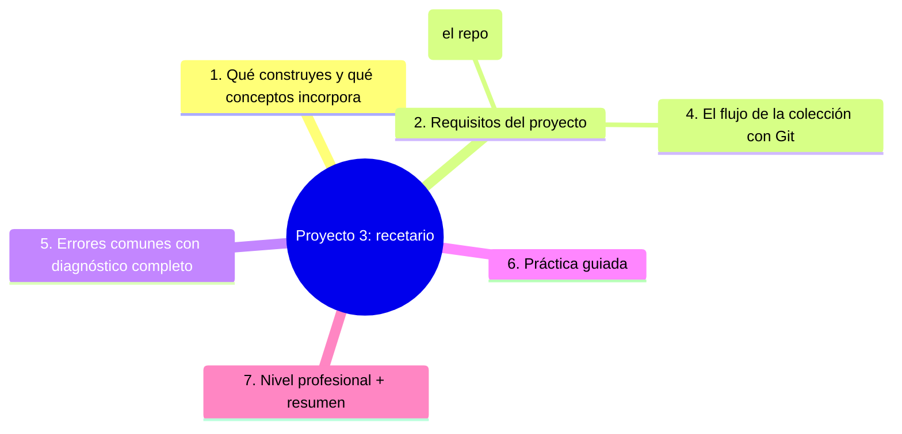
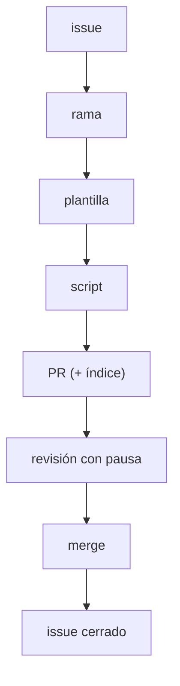

# Proyecto 3: recetario

## Introducción

El Proyecto 3 cambia el foco: de entradas por fecha a una **colección con estructura interna** — un recetario donde cada receta es una pequeña «ficha de datos» con campos fijos y una categoría. Aquí se practica lo que en un equipo se vuelve exigencia: estructura como contrato, índice vivo, búsqueda de recetas por ingrediente con code search y el primer check automatizado sobre contenido. Es el puente entre «sé versionar escritura» (Proyecto 2) y «sé construir un producto con estructura verificable» (Proyecto 4 en adelante).

---

## Mapa conceptual de este capítulo



---

## 1. Qué construyes y qué conceptos incorpora

```text
EL PROYECTO:
    │
    ├── un recetario: 10+ recetas con campos fijos
    │   (nombre, tiempo, raciones, ingredientes, pasos,
    │   etiquetas) y carpetas por categoría
    │
    └── un índice vivo (README) y un check estructural
        que garantiza que cada receta cumple la
        plantilla (secciones 14, 16, 19)
```

```text
CONCEPTOS NUEVOS (secciones 14, 16, 19):
    │
    ├── campos fijos = primer «esquema» de texto
    │   (sección 14)
    ├── categorías y etiquetas como convención
    │   (sección 16)
    ├── índice como documento vivo (sección 14)
    ├── búsqueda de código: hallar una receta por
    │   ingrediente (sección 04 — práctica en la web)
    └── primer check sobre contenido: script que valida
        campos + workflow en PR (sección 19)
```

```text
    │
    └── el aprendizaje central: ESTRUCTURA es una
        promesa — cuando cada receta garantiza los
        mismos campos, el índice y los checks dejan de
        ser trabajo manual y se vuelven consecuencia
        del flujo (Error 1 si cada receta tiene su
        propio formato)
```

---

## 2. Requisitos del proyecto

```text
CONTENIDO:
    │
    ├── 10+ recetas en 3–4 categorías (recetas reales,
    │   no lorem ipsum — Error 2 si todo queda en una
    │   sola categoría: no hay taxonomía)
    ├── plantilla de receta con campos fijos que se
    │   copia al escribir (Error 3 si cada receta
    │   inventa sus campos)
    └── índice por categorías en el README con enlace a
        cada receta (Error 4 si se desincroniza de las
        recetas)
```

```text
CONVENCIONES (escríbelas en el README):
    │
    ├── nombres de archivo: kebab-case sin acentos
    │   (slug: `cenas/pasta-al-pesto.md`)
    ├── campos obligatorios: tiempo, raciones,
    │   ingredientes (lista), pasos (numerados),
    │   etiquetas
    └── taxonomía: máx. 4 categorías, una carpeta por
        categoría (Error 5 si las categorías se
        multiplican «por necesidad»)
```

```text
AUTOMATIZACIÓN (sección 19 cap. 01/02):
    │
    ├── script de validación (Python o PowerShell):
    │   verifica que cada `recetas/**/*.md` trae los
    │   campos obligatorios
    ├── workflow que lo corre en PR y en push a main
    │   (triggers `pull_request` + `push`)
    └── prueba: receta con campos faltantes → check
        rojo (Error 6 si nunca demuestras que el check
        bloquea)
```

```text
    │
    └── el check es tu primera «puerta de calidad»: el
        Proyecto 4 la convierte en pipeline completo
        con build y despliegue
```

---

## 3. La estructura de una receta (el repo)

```text
ESTRUCTURA SUGERIDA (la tuya puede variar, pero
documenta):
    │
    ├── README.md        → índice por categorías + cómo
    │                      añadir + convenciones
    ├── plantilla/
    │     receta.md      → plantilla a copiar
    ├── recetas/
    │     01-cenas/      → una carpeta por categoría
    │     02-postres/
    │     03-bebidas/
    ├── scripts/
    │     validar.py     → validación de campos
    └── .github/
          workflows/     → check estructural
```

```text
LA PLANTILLA (campos fijos — Error 3):
    │
    ├── título (H1)
    ├── datos: tiempo, raciones, dificultad
    │   ingredientes (lista markdown)
    ├── pasos (lista numerada)
    └── etiquetas (para filtros futuros — serán
        metadatos en el proyecto de datos)
```

```text
    │
    └── la plantilla es el contrato: el script, el
        índice y la búsqueda solo funcionan si todas
        las recetas la cumplen (sección 14)
```

---

## 4. El flujo de la colección con Git

```mermaid
flowchart TD
    A["1. issue: «receta solicitada X» con etiqueta de categoría (sección 16)"] --> B["2. rama desde la base actual: `receta/agrega-pasta-pesto`"]
    B --> C["3. copias la plantilla y escribes la receta (commit: «Agrega receta: título\")"]
    C --> D["4. check local: corres el script de validación y pasa (no esperes al CI)"]
    D --> E["5. PR con contexto (qué receta y por qué) + actualización del índice en el MISMO PR"]
    E --> F["6. revisión con pausa (tú de mañana o segundo lector — sección 15)"]
    F --> G["7. merge → check verde → issue cerrado (Error 6 si el issue queda abierto)"]
```

```text
    │
    └── variación: buscar recetas por ingrediente con
        code search desde la web — práctica: «¿qué
        recetas llevan camarón?» con una búsqueda que
        llega al resultado sin abrir cada archivo
        (sección 04)
```

```text
    │
    └── con 10 ciclos, el recetario deja de ser «un
        montón de textos» y se convierte en colección
        con contrato — y eso es lo que entrega el
        Proyecto 3
```

---

## 5. Errores comunes con diagnóstico completo

### Error 1: cada receta con su propio formato

**Qué ocurrió:** 12 recetas y 8 formas distintas de escribir los ingredientes; la búsqueda y el script no sirven para nada.

**Por qué:** plantilla no aplicada (punto 2 Error 3).

**Cómo comprobarlo:** abre 3 recetas: ¿los campos están en el mismo orden?

**Opciones:** crear la plantilla y unificar las existentes en un commit dedicado.

**Riesgos:** la colección no escala.

**Solución:** plantilla como contrato (punto 3).

**Cómo se evita:** «¿dónde está la plantilla?» en la checklist de entrega.

---

### Error 2: colección de una sola categoría

**Qué ocurrió:** todas las recetas son «cena»; la taxonomía se inventó «cuando hacía falta».

**Por qué:** categorías sin convención (punto 2 Error 5).

**Cómo comprobarlo:** ¿el README documenta las categorías? ¿se cumplen en todo?

**Opciones:** definir la taxonomía (3–4) y mover las recetas a sus carpetas.

**Riesgos:** fragmentación creciente por cada categoría nueva.

**Solución:** taxonomía escrita (punto 2).

**Cómo se evita:** categoría nueva = decisión documentada en el README, no impulso.

---

### Error 3: plantilla existe pero no se aplica

**Qué ocurrió:** el script pasa, pero 4 recetas tienen campos desordenados o faltantes.

**Por qué:** check decorativo (punto 2 Error 6).

**Cómo comprobarlo:** corre el script sobre main: ¿detecta la receta incompleta?

**Opciones:** exigir el check en PR y probarlo en negativo AHORA.

**Riesgos:** falsa sensación de calidad.

**Solución:** check bloqueante + prueba negativa (punto 2).

**Cómo se evita:** todo control nuevo se demuestra que bloquea.

---

### Error 4: índice desincronizado

**Qué ocurrió:** el README lista 7 recetas; el repo tiene 11; dos enlaces apuntan a recetas que cambiaron de carpeta.

**Por qué:** el índice no formó parte del ciclo (punto 4 paso 5).

**Cómo comprobarlo:** contrasta los enlaces del README contra los archivos de `recetas/`.

**Opciones:** actualizar el índice en el mismo PR de la receta (regla); verificar enlaces en la checklist del PR.

**Riesgos:** documentación que miente (Error 4 sección 14 cap. 04).

**Solución:** índice en el ciclo (punto 4).

**Cómo se evita:** «receta añadida = índice actualizado» escrito en el README.

---

### Error 5: etiquetas sin convención

**Qué ocurrió:** la misma receta aparece con `postres`, `dulce` y `postre`; los filtros por etiqueta no sirven.

**Por qué:** taxonomía libre (punto 2 Error 5).

**Cómo comprobarlo:** cuenta las etiquetas distintas: ¿coinciden con la taxonomía documentada?

**Opciones:** unificar un solo nombre por categoría; limpiar duplicados.

**Riesgos:** metadatos que se vuelven ruido.

**Solución:** taxonomía escrita y acotada (punto 3).

**Cómo se evita:** elección de etiquetas desde la lista documentada.

---

### Error 6: ciclo sin cerrar

**Qué ocurrió:** 4 issues de «receta solicitada»; todos mergueados, ninguno cerrado.

**Por qué:** el cierre no formaba parte del ciclo (punto 4 paso 7).

**Cómo comprobarlo:** issues abiertos vs. recetas mergueadas.

**Opciones:** cerrar con enlace a la receta; regla: cierre dentro del PR.

**Riesgos:** tablero que miente (Error 2 sección 16 cap. 05).

**Solución:** cierre en el ciclo (punto 4).

**Cómo se evita:** checklist: merge + índice + check verde + issue cerrado.

---

## 6. Práctica guiada

### Objetivo

Entregar un recetario con 10+ recetas, 3 categorías, índice en sincronía y check estructural que bloquea.

### Paso 1: estructura

1. Repo + estructura del punto 3 + plantilla + convenciones en el README.

### Paso 2: las 3 primeras recetas a mano

1. Sin CI aún: escribe las 3 primeras con el ciclo completo (punto 4) — el flujo se vuelve hábito antes de automatizarlo.

### Paso 3: el check estructural

1. Script `validar.py`: campos obligatorios por archivo. Ejecútalo en local: ¿detecta una receta incompleta?
2. Workflow en PR y push (sección 19 cap. 02). Prueba negativa: receta sin ingredientes → check rojo que bloquea el merge.

### Paso 4: el resto de la colección



1. Repite hasta llegar a 10+ recetas en 3 categorías.

### Paso 5: práctica de búsqueda

1. Desde la web: «¿qué recetas llevan camarón?» sin abrir cada archivo (code search — sección 04).

### Paso 6: entrega

```text
Checklist:
    [ ] 10+ recetas con la plantilla
    [ ] 3–4 categorías documentadas
    [ ] índice README en sincronía (sin enlaces rotos)
    [ ] check estructural requerido (probado en negativo)
    [ ] issues cerrados con enlace a la receta
```

### Resultado esperado

Colección donde el índice, la búsqueda y el check funcionan porque la estructura está garantizada — no porque alguien la revise a mano.

### Ejercicio de transferencia
Aplica el mismo concepto de estructura como contrato a un proyecto de gestión de inventario: crea un repositorio para un inventario de productos, define una plantilla fija para cada producto (nombre, SKU, cantidad, ubicación), usa un script para validar la plantilla en cada PR, y mantén un índice en el README que se actualice automáticamente.

### Conclusión esperada

Cuando cada receta garantiza los mismos campos, la colección deja de ser «texto acumulado» y pasa a comportarse como un sistema: se agrega, y el contrato se mantiene. Eso es exactamente lo que entrega el Proyecto 3.

---

## 7. Nivel profesional + resumen

### 7.1. De este proyecto a la vida real

```text
    │
    ├── campos fijos = primer anticipo del modelo de
    │   datos: en el Proyecto 6 esto se vuelve esquema
    │   con aserciones (sección 21 cap. 05/06)
    │
    ├── el check estructural es el antecesor del
    │   lint/validación del pipeline que el Proyecto 4
    │   convierte en fábrica de calidad completa
    │   (sección 19/22)
    │
    ├── categorías + etiquetas = metadatos: la materia
    │   prima para filtros y estadísticas (anticipo de
    │   la sección 21)
    │
    ├── índice + búsqueda = cómo un equipo documenta y
    │   recupera su conocimiento (sección 14)
    │
```

### 7.2. Resumen

En este capítulo aprendiste que:

* la estructura es una promesa: plantilla con campos fijos = contrato de la colección;
* el ciclo de la receta (issue → rama → plantilla → script → PR con índice → revisión con pausa → merge → cierre) se practica 10 veces hasta ser hábito;
* el primer check sobre contenido (validación de campos) es el puente entre «escribir» y «producto verificado»;
* el índice se actualiza en el mismo PR que la receta: nunca se desincroniza;
* los errores típicos (formatos propios, una sola categoría, check decorativo, índice desincronizado, etiquetas duplicadas, issues sin cerrar) se previenen con plantilla y ciclo;
* la progresión lleva la estructura al Proyecto 4, con página web, pipeline y despliegue.

La idea principal es:

> **Un recetario enseña que la estructura es una promesa: cuando cada receta garantiza los mismos campos, el índice, la búsqueda y los checks dejan de ser trabajo manual y se vuelven consecuencia del flujo.**

---

## Autopreguntas de cierre

Sin mirar el material, responde mentalmente y luego compruébalo con este capítulo:

1. ¿Por qué es importante que cada receta tenga los mismos campos fijos en un recetario estructurado?
2. ¿Cómo contribuye el índice vivo en el README a la utilidad del recetario como colección?
3. ¿Qué papel juega el check estructural en el flujo de trabajo con pull requests?
4. ¿Cómo asegura el ciclo issue → rama → plantilla → script → PR → revisión → merge → cierre la calidad y la trazabilidad?
5. ¿De qué manera la progresión del recetario al proyecto de página web refleja la evolución de un producto de texto a un producto con pipeline de calidad?
6. ¿Qué riesgos existen si cada receta utiliza su propio formato y cómo se mitigan con la plantilla como contrato?
7. ¿Cómo permite la búsqueda por ingrediente con code search recuperar conocimiento sin abrir cada archivo?
8. ¿Por qué es necesario practicar el ciclo múltiples veces hasta convertirlo en hábito?
## Próximo paso

Tu colección ya tiene estructura que se verifica sola.

Ahora el Proyecto 4: una página web con checks, calidad y primer pipeline formal.

Continúa con:

[`04-proyecto-4-pagina-web.md`](04-proyecto-4-pagina-web.md)