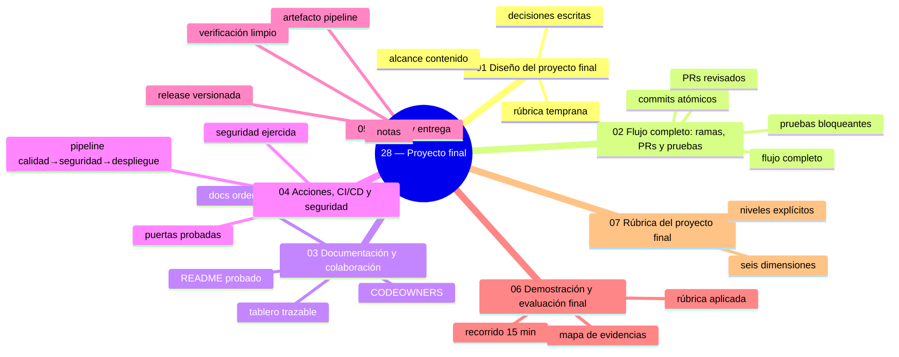
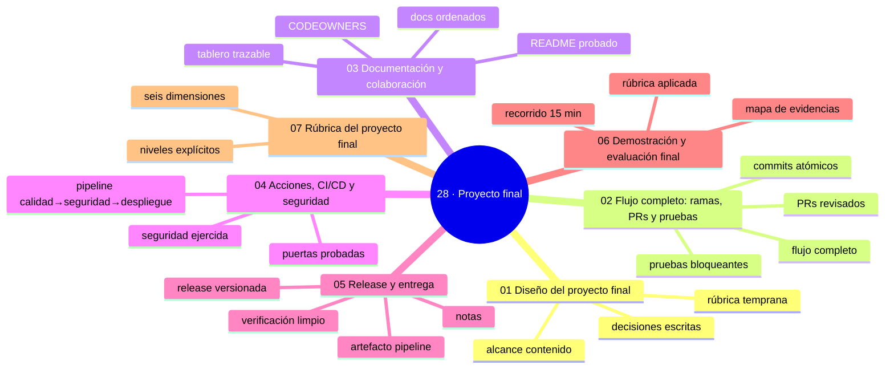

# 28 — Proyecto final

## Bienvenido a esta sección

## Mapa conceptual de este capítulo

## Mapa conceptual

El Proyecto final reúne todo lo aprendido en un solo entregable. El objetivo no es solo terminar un proyecto: es **demostrar que comprendes el flujo completo** — código, documentación, Git, GitHub, ramas, commits, Pull Requests, pruebas, GitHub Actions, seguridad, CI/CD y release — con evidencias encontrables en el repositorio. Esta sección te acompaña desde el diseño hasta la demostración.

## En esta sección estudiarás

* diseño con alcance contenido, decisiones escritas y rúbrica temprana;
* el flujo completo ejecutado: ramas, commits, PRs y pruebas bloqueantes;
* documentación y colaboración que otros puedan seguir sin ti;
* GitHub Actions con puertas probadas, seguridad ejercida y despliegue con reversa;
* release versionada con notas, artefacto y verificación en limpio;
* la demostración: mapa de evidencias, autoevaluación y recorrido ensayado.

## Objetivos de aprendizaje

Al terminar esta sección serás capaz de:

* diseñar un proyecto con alcance contenido, decisiones escritas y rúbrica temprana;
* ejecutar el flujo completo: ramas, commits atómicos, PRs y pruebas bloqueantes;
* documentar y colaborar de modo que otros puedan seguir el proyecto sin ti;
* operar GitHub Actions con puertas probadas, seguridad ejercida y despliegue con reversa;
* publicar un release versionado con notas, artefacto y verificación en limpio;
* demostrar el aprendizaje con un mapa de evidencias y un recorrido ensayado.

---
## ¿Qué aprenderás en esta sección?

1. [`01-diseno-del-proyecto-final.md`](01-diseno-del-proyecto-final.md) — alcance, decisiones y rúbrica antes de codificar.
2. [`02-flujo-completo-ramas-prs-pruebas.md`](02-flujo-completo-ramas-prs-pruebas.md) — seis ciclos sin saltos.
3. [`03-documentacion-y-colaboracion.md`](03-documentacion-y-colaboracion.md) — README probado, docs ordenados, tablero y dueños.
4. [`04-actions-ci-cd-y-seguridad.md`](04-actions-ci-cd-y-seguridad.md) — la fábrica con puertas que cierran.
5. [`05-release-y-entrega.md`](05-release-y-entrega.md) — versión, notas, artefacto y verificación en limpio.
6. [`06-demostracion-y-evaluacion-final.md`](06-demostracion-y-evaluacion-final.md) — el recorrido de 15 minutos con evidencias.
7. [`07-rubrica-del-proyecto-final.md`](07-rubrica-del-proyecto-final.md) — la rúbrica pública: seis dimensiones y niveles.

---
## Cómo estudiar esta sección

Cada capítulo produce entregables concretos (propuesta, PRs, README, pipeline, release, mapa de evidencias). Trabájalos en orden: la rúbrica (capítulo 07, escrita de forma temprana en el 01) gobierna los demás, y el capítulo 06 es la culminación. Si un elemento falta, vuelve al capítulo teórico correspondiente — esta sección es un ensamblaje, no nueva teoría.

## Referencias

* Las secciones 22–26 de este curso (CI/CD, DevOps, DevSecOps, nivel senior).
* La rúbrica de esta sección: [`07-rubrica-del-proyecto-final.md`](07-rubrica-del-proyecto-final.md).
* GitHub — Documentación oficial: «About releases».

---
## Checkpoint 28 — Comprobación obligatoria
1. Revisa que tu rama principal esté verde y que todos los checks pasen.
2. Verifica que tengas al menos 6 Pull Requests con revisión real y evidencia de pruebas bloqueantes.
3. Confirma que tu release esté publicada con notas, artefacto y verificación en limpio.
4. Asegúrate de tener un mapa de evidencias completo con enlaces a cada elemento del flujo.
5. Ejecuta el recorrido de 15 minutos desde el README sin ayuda externa.
Si puedes hacerlo **sin mirar instrucciones**, el checkpoint está cerrado.

## Autopreguntas de cierre

Sin mirar el material, responde mentalmente y luego compruébalo con los capítulos de la sección:
1. ¿Cuáles son las seis dimensiones de la rúbrica de este proyecto?
2. ¿Qué significa «puertas probadas» en tu pipeline?
3. ¿Cómo verificas que el release funciona «en limpio»?
4. ¿Qué es un mapa de evidencias y para qué sirve?
5. ¿Cómo aseguras que el historial de commits sea legible y distinguible por tipo?

---
## Próximo paso

Cuando termines los siete capítulos, continúa con la siguiente sección:

[`../29-errores-comunes/`](../29-errores-comunes/)